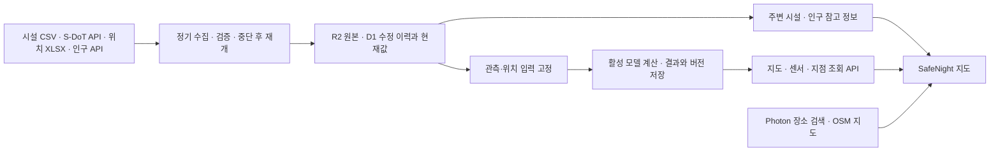
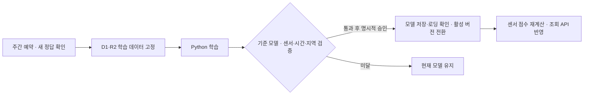

# SafeNight

**밤길의 조도·소음과 주변 시설·인구 정보를 관측 시각과 함께 확인하는 지도 서비스.**

[사이트 열기](https://safenight-seoul-2026.true-tang-8939.chatgpt.site/) · [데이터 출처](docs/data-sources.md) · [실행·검증 기록](docs/evidence/final-checks.txt)

## 1. 분석의 취지

통계청의 2024년 사회조사에서 전국 13세 이상 인구의 **30.5%**가 밤에 혼자 걸을 때 불안을 느꼈다. 불안을 느낀 응답자 중 26.4%는 인적이 드문 점을, 16.9%는 가로등·CCTV 등 안전시설 부족을 주된 이유로 꼽았다. [통계청 원문, 40쪽](https://sri.kostat.go.kr/boardDownload.es?bid=219&list_no=433638&seq=8)

이 문제에서 출발해 **공개 환경 관측과 주변 정보를 한곳에서 비교할 수 있을까?**를 질문했다. 서울시가 공개하는 S-DoT 조도·소음을 센서 위치와 연결하고, 시설·인구를 지도에 함께 표시했다. 이어 RF와 PDP로 환경 점수의 재현 오차와 설명 가능성을 검토했다. [서울시 S-DoT 설명](https://news.seoul.go.kr/gov/archives/539344)

## 2. 파이프라인과 사이트 사용 영상


[시연 영상 MP4](docs/assets/safenight-demo.mp4) — 2026-11-05 실제 배포 사이트의 사용 단계를 캡처했다. 새 수집 연결 코드의 운영 배포와는 구분한다.



| 데이터 | 새 코드의 수집·반영 방식 |
|---|---|
| 센서 위치 XLSX | 매일 02:45 KST 최신 파일 확인. 해시가 바뀌면 검증·적재, 같으면 재적재 생략 |
| S-DoT 조도·소음 | 매일 03:00 KST 전날·누락 구간과 최근 7일 정정 확인 |
| 송파·서초 시설 | 매일 03:15 KST 공개 데이터 브랜치 게시 후 D1/R2 반영 확인 |
| 공개 구역 인구 | 121개 구역을 4시간마다 수집. 조회 시 갱신과 10분 캐시·요청 임대 병행 |

**D1/R2를 웹 서비스의 기준 저장소로 정했다.** D1은 수집 작업·수정본 → 공개 이력 → 고정 입력·학습 데이터 → 모델·활성 버전 → 예측 결과를 연결한다. R2는 원본과 고정 파일을 해시로 보존하고, Python은 고정 데이터를 읽어 학습한다. [33개 테이블·238개 컬럼의 DB 구조와 ERD](docs/database-structure.md)



새 관측만으로 정답이 생기지는 않는다. 정답이 없으면 학습을 보류한다. 정기 실행은 Worker 배포·DB 마이그레이션·Secrets 및 `SAFENIGHT_PIPELINE_ENABLED=true` 설정 후 사용할 수 있다. [운영·실행 안내](cloud/README.md)

## 3. 분석 노트북과 발견한 인사이트

| 노트북 | 질문과 확인한 내용 |
|---|---|
| [① 데이터 병합](notebooks/safenight-data-integration.ipynb) | 센서 ID로 관측·위치를 다대일 병합하고, 위치별 CCTV를 공간 집계했다. 2026-11-03 야간 관측 **3,834행·947센서**를 확보했으며, 미확보 조명 자료는 결측으로 유지했다. |
| [② RF·블록 PDP 점수 연구](notebooks/safenight-pdp-score-research.ipynb) | 기존 RF의 시설 수 증가 시 점수 역전을 확인하고, 관련 변수를 묶은 PDP와 단조·포화 제약·계수 보정으로 점수를 재구성했다. |

두 번째 연구는 **2025-10-12의 3,713행·671좌표**를 학습 402곳·보정 134곳·평가 135곳으로 분리했다. 아래 오차는 평가 743행에서 좌표마다 같은 비중을 준 **기존 규칙식 재현 오차**다. 낮을수록 좋다.

| 방법 | MAE(점) | RMSE(점) |
|---|---:|---:|
| 기존 10입력 RF | 0.6654 | 1.2498 |
| 변수별 PDP 단순 합 | 0.7211 | 1.2224 |
| 조도·소음 블록 PDP 합 | 0.4723 | 0.8617 |
| 시설 제약·별도 보정까지 적용 | **0.4025** | **0.8025** |

**PDP를 단순히 더하는 것만으로는 좋아지지 않았다.** 관련 변수를 묶고 시설 곡선을 학습 자료에서만 구한 뒤, 보정 자료에서 계수를 추정했을 때 RF 대비 MAE가 **39.5% 감소**했다. 시설 수를 늘리는 모의 비교 17,089쌍의 역전은 **1,263건 → 0건**이었다. 개선은 블록화·제약·보정을 합친 결과다. [결과 CSV](docs/notebook-results/results.csv) · [방향 검사](docs/notebook-results/constraints.csv)


하루·단일 분할의 연구이며, 원자료 재현을 위해 중복 583행과 위경도 반전 11행을 유지했다. 가로등이 있는 보정 좌표가 없어 해당 계수는 1로 고정했다. 두 노트북의 날짜·표본은 다르며, 이 수치는 실제 안전 예측력이나 현재 사이트 모델의 성능을 뜻하지 않는다. [재현 방법과 입력 해시](notebooks/README.md)

## 4. 스코어링 방법과 타당성

원래 규칙은 조도·소음·소음 변동 대리값의 부담과 CCTV·가로등·보안등의 보완항을 결합했다. 연구에서는 이를 기준으로 위험 대용점수 R을 만들었다. **R은 낮을수록, 환경 참고점수 S는 높을수록 좋다.**

```text
원래 기준 R₀ = clip(0.30I + 0.15N + 0.10T − 0.25C − 0.15G − 0.05B, 0, 50)
재구성 R = clip(절편 + Σ 비음수 계수 × 보정한 블록 PDP 성분, 0, 50)
환경 참고점수 S = 100 − R
```

타당성을 확인한 범위는 **산식 재현과 설계 조건의 일관성**이다. 관련 입력을 묶어 해석하고, 시설 수가 늘 때 위험점수가 증가하지 않도록 했으며, 계수 보정과 평가 좌표를 분리했다. 가중치·소음 구간·시설 포화점은 설계 가정으로, 사회조사나 낮은 재현 오차가 그 현실 타당성을 입증하지는 않는다. [원식과 세부 정의](docs/scoring-and-serving.md)

**현재 사이트는 별도의 조도·소음 2입력 RF를 사용한다.** 시설·인구는 참고 정보이며 점수에 합산하지 않는다. 센서 분리 평가 MAE 8.2808점으로 중앙값 기준 7.9466점보다 오차가 컸다. 연구 점수의 사이트 적용은 새 입력 계약과 별도 검증이 필요하다. [서비스 모델 비교·PDP](docs/model-analysis/metrics.json)

## 5. UI: 수치와 근거를 함께 확인


- **검색 → 위치 선택 → 관측 확인:** Photon 검색 결과와 주변 센서의 조도·소음·관측 시각을 표시한다.
- **계산 근거:** 지점 점수에 사용한 센서·거리·반영 비중을 펼쳐 볼 수 있다.
- **주변 정보:** 시설의 설치 기록과 인구 구역의 추정 범위·포함 관계·자료 시각을 구분한다.
- **산출 보류:** 오래된 관측, 입력 부족, 모델 지원 범위 밖이면 점수 대신 사유를 표시한다.

RF·PDP 연구, DB·서버 구현과 지도 UI를 연결했지만 실제 범죄·사고 확률이나 안전 경로를 제공하지는 않는다. 구현·검증에는 Codex, 초기 UI에는 Google AI Studio·React를 활용했다.
