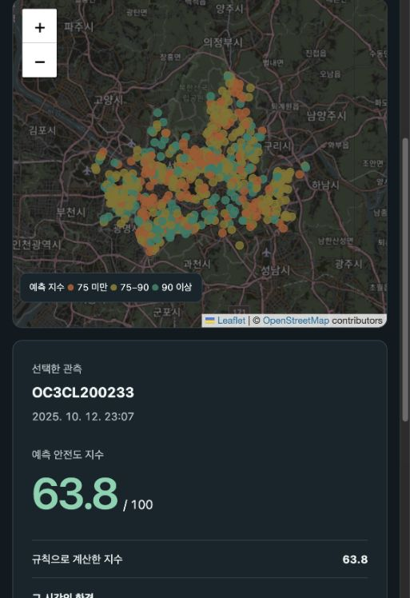

# SafeNight

밤길의 조도·소음과 주변 안전시설을 한 지점, 한 시각 단위로 결합해 안전도 지수를 탐색하는 프로젝트입니다.



## 문제와 아이디어

밤길의 환경은 시설이 있는지 여부만으로 설명하기 어렵습니다. 같은 장소라도 시간에 따라 밝기와 소음이 달라집니다. SafeNight은 시설의 위치 정보에 해당 시각의 환경 센서값을 더해, 장소와 시간을 함께 읽는 방식을 만들었습니다.

## 데이터 결합

분석 단위는 **센서 한 곳의 특정 시각 관측**입니다. S-DoT 환경정보에서 조도·소음을, 설치 위치에서 위도·경도를, CCTV·가로등·보안등 자료에서 주변 시설 좌표를 가져왔습니다.

센서와 시설 사이의 거리는 Haversine 공식으로 계산했습니다. 위도·경도를 지구 표면의 거리로 바꾸는 방식이라 반경 25m 안의 시설을 일관된 기준으로 셀 수 있습니다. 이렇게 만든 입력은 조도 3개, 소음 3개, 소음 범위 1개, 시설 집계 3개로 구성됩니다.

| 자료 | 프로젝트에서 사용한 정보 |
| --- | --- |
| S-DoT 환경정보 | 시간별 조도·소음 최대·평균·최소 |
| 센서 설치 위치 | 센서 ID, 위도·경도 |
| CCTV·가로등·보안등 | 반경 25m 안의 시설 좌표 행 수 |

## 안전도 수치화

조도·소음에서 환경 부담을 계산하고, 주변 시설에서 보완 점수를 더해 `safety_index`를 만들었습니다.

```text
안전도 지수 = clip(100 - 환경 부담 + 시설 보완, 0, 100)
```

가중치와 임계값은 프로젝트의 설계 기준입니다. 따라서 이 지수는 실제 범죄 확률이 아니라, 입력한 환경 조건을 비교하기 위한 평가값입니다. 전체 수식은 [METHOD.md](docs/METHOD.md)에 정리했습니다.

## Random Forest

조도(lux), 소음(dB), 시설 집계처럼 단위가 다른 값이 함께 들어가고, 조도·소음의 구간 기준과 시설 점수 상한처럼 직선으로 표현하기 어려운 조건이 있어 Random Forest를 사용했습니다. 114개의 나무가 여러 표본에서 만든 예측을 평균해 단일 결정나무보다 안정적인 값을 만들도록 했습니다.

같은 좌표가 학습과 평가에 섞이지 않도록 좌표별 GroupKFold 5-fold 검증을 적용했습니다.

| 모델 | OOF RMSE | OOF MAE | OOF R² |
| --- | ---: | ---: | ---: |
| 학습 평균값 | 9.4546 | 8.0331 | -0.0048 |
| 선형 회귀 | 7.9327 | 2.8825 | 0.2926 |
| 단일 결정나무 | 1.2337 | 0.4421 | 0.9829 |
| Random Forest | **0.8849** | **0.3505** | **0.9912** |

이 값은 정해 둔 지수를 얼마나 재현하는지 보여주는 결과입니다. 모델 코드와 모델별 수치는 [src/train.py](src/train.py), [results/benchmark.json](results/benchmark.json)에서 확인할 수 있습니다.

## 데이터 점검

센서 CSV의 열 구조를 점검해 조도·소음의 실제 열을 사용했습니다. 좌표가 뒤바뀐 센서 2곳의 11개 행을 제외하고, 동일 센서·시각의 반복 관측 378개를 정리해 최종 **3,230행·652개 좌표**를 만들었습니다.

시설 집계는 제공된 좌표 행을 센 결과입니다. 특히 보안등 집계에는 같은 좌표의 반복이 포함될 수 있으므로, 물리적인 시설 수와 동일하다고 해석하지 않았습니다. 데이터의 범위와 한계는 [DATA.md](docs/DATA.md)에 기록했습니다.

## 사이트와 코드

사이트에서는 시간과 센서를 선택해 지수·조도·소음·주변 시설을 지도에서 확인할 수 있습니다. `내 위치 사용`을 허용하면 현재 위치 주변의 같은 시간대 센서 최대 8개를 거리 가중해 추정값을 표시합니다. 가까운 센서일수록 더 크게 반영됩니다.

```bash
python3 -m http.server 8765 --bind 127.0.0.1 --directory site
```

```bash
uv run src/train.py
```

| 경로 | 내용 |
| --- | --- |
| `site/` | 지도 웹사이트 |
| `src/scoring.py` | 안전도 지수 계산 |
| `src/prepare.py` | 데이터 정리 |
| `src/train.py` | Random Forest 학습·검증 |
| `data/processed/` | 최종 입력·예측 데이터 |
| `docs/` | 데이터·수식·실행 설명 |

2026-10-31 · 서울시 공개 자료를 활용한 개인 프로젝트
