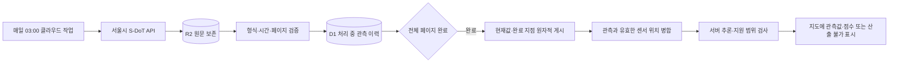

# SafeNight

**서울시 환경 관측을 수집·보존하고 지도에서 확인하는 웹서비스**

밤길의 주변 환경을 살펴볼 때 관측값과 관측 시각을 함께 확인하도록 만들었습니다. 서울시 S-DoT의 조도·소음을 센서 위치와 연결하고, 지도에서 지점을 선택하면 환경 관측과 **실험용 환경 안전도**를 보여 줍니다.

**[사이트 열기](https://safenight-seoul-2026.true-tang-8939.chatgpt.site/)** · **[실적 설명서](docs/project-achievements.md)** · **[제출용 PDF](output/pdf/SafeNight_실적설명서.pdf)**

현재 사이트는 소유자의 ChatGPT 계정으로 접속합니다. 점수는 기존에 계산한 `safety_index`를 학습한 실험 결과이며, 실제 범죄·사고 확률이나 보행 안전을 보장하지 않습니다.


2026-11-04 로컬 화면 검증 캡처입니다. 클라우드의 수집·배포 결과는 아래 운영 기록과 구분합니다.

## CSV 시연에서 클라우드 서비스로

초기에는 CSV 결과를 React 지도에 연결했습니다. 이후 자료가 갱신될 때마다 수동으로 파일을 바꾸는 구조를 개선하기 위해 수집·원문 보존·관측 이력·현재값 게시를 분리했습니다. 현재 사이트의 서버·DB·추론은 클라우드에서 실행하며, 로컬 컴퓨터나 Docker를 켜 둘 필요가 없습니다.

지도에서 관측 지점을 선택하거나 센서·지역명을 검색하면 조도·소음과 실제 관측 시각을 확인합니다. 오래된 관측, 입력 부족, 지원 범위 밖에서는 점수를 만들지 않습니다. 화면 새로고침은 저장된 자료를 다시 조회하며, 원천 수집이나 재학습을 시작하지 않습니다.

CCTV 조회·영상·인원 검출 기능은 제거했습니다. 현재 정기 수집 대상은 S-DoT이며, 센서 위치는 공식 공개 파일을 검증해 적재합니다.

## 확인한 구현과 운영 결과

2026년 11월 4일 KST 기준입니다. 세부 근거와 검증 범위는 [실행 검증 기록](backend/VALIDATION.md)에 있습니다.

| 항목 | 확인 결과 |
|---|---|
| 실제 원천 수집 | Sites 서버가 2026-11-03 하루의 S-DoT 응답 29,200행 직접 수집 |
| 센서 위치 | 공식 2026-03-10 공개 파일의 위치 1,170개 적재 |
| 이관·저장 | 기존 관측·위치 이력 25,885개 이전, 실수집 후 총 28,585개 확인 |
| 클라우드 코드 | 87개 시험 통과, TypeScript 검사·배포 빌드 통과 |
| 로컬 Python 서버 | 실제 PostgreSQL을 사용하는 76개 시험과 Ruff·Basedpyright 통과 |
| 정기 수집 | 매일 03:00 Asia/Seoul 일정 등록·활성화 |

실수집은 로컬 API와 Docker를 중지한 상태에서 확인했습니다. 응답 행과 관측·위치 이력은 장소 수나 이용자 수를 뜻하지 않습니다. 첫 정기 예약은 **2026-11-05 03:00**으로, 작성 시점에는 예약 실행 전입니다. 코드 시험과 실제 원천 수집, 일정 저장, 장기간 운영 검증을 구분합니다. GitHub Actions 성공 여부도 로컬 시험 기록과 별도로 확인해야 합니다.

## 수집에서 지도까지

| 구성 | 역할 |
|---|---|
| Sites / Cloudflare Workers | 지도 화면, 서버 API, 요청 시 추론 |
| D1 | 불변 관측 이력, 현재값, 수집 작업·페이지·완료 지점 |
| R2 | SHA-256으로 구분한 원문 응답과 이전 자료 백업 |
| 연결된 클라우드 일정 | 전날·누락 구간 수집과 최근 7일 정정 재검사 |



한 요청은 최대 200행 한 페이지를 처리하며, 중단되면 저장된 다음 페이지에서 재개합니다. 전체 페이지 검증 전에는 부분 자료를 현재값으로 게시하지 않습니다. 실패나 정정을 추적할 수 있도록 원문과 이전 이력을 보존합니다. 새 관측이 들어와도 모델을 자동으로 다시 학습하지 않습니다.

## 코드 구조와 개발

| 경로 | 내용 |
|---|---|
| [`cloud/`](cloud/README.md) | 현재 Sites 실행본: 지도·API·S-DoT 수집·D1/R2·서빙 |
| [`backend/`](backend/README.md) | 개발·재현용 Python 서버와 PostgreSQL 파이프라인 |
| [`work/safenight/`](work/safenight/README.md) | 로컬 React 지도 화면 |
| [`docs/`](docs/project-achievements.md) | 실적 설명서와 모델 교체 안내 |

클라우드 소스의 검사·빌드는 다음과 같습니다.

```sh
cd cloud
npm ci
npx tsc --noEmit
node --test tests/*.test.mjs
npm run build
```

운영 배포에는 Sites의 D1·R2, 비밀 설정, 소스 동기화·패키징 절차가 필요합니다. `npm run build`만으로 운영 저장소가 만들어지지는 않습니다. 로컬 Python 실행은 [백엔드 안내](backend/README.md), 수집 인증·재개·완료 확인은 [클라우드 운영 절차](cloud/public/CLOUD_OPERATIONS.md)를 참고하세요.

현재 RandomForest는 교체 가능한 실험용 구성입니다. 같은 입력·출력 계약을 유지하는 교체와 새 입력 변수를 추가하는 변경을 구분해 [모델 교체 안내](docs/model-replacement.md)에 정리했습니다. 새 버전은 독립 평가와 fixture 확인을 거쳐 배포합니다.

## 현재 범위와 다음 작업

센서 위치 새 파일 자동 탐지, 가로등·보안등 추가 수집은 후속 과제입니다. 검색은 관측 지점·지역명을 대상으로 하며, 임의 주소 전체의 거리 가중 평가, 안전 우회 경로, 실제 SOS 전송, 경찰서·공공기관 전화 안내는 현재 제공하지 않습니다. 현실 안전 예측력과 장기간의 부하·장애 복구는 별도 검증이 필요합니다.

API 키, 운영 토큰, DB 비밀번호, DB 덤프와 개발 캐시는 공개 저장소에 포함하지 않습니다. 원본 포트폴리오는 보존하고, 모델 내용을 제외한 최신 실적 설명서를 별도로 정리했습니다.
