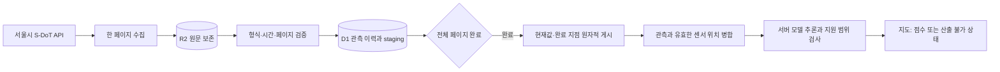

# SafeNight

서울시 S-DoT의 조도·소음과 센서 위치를 지도에서 확인하는 웹서비스입니다. 지점을 선택하면 환경 관측값, 관측 시각, **실험용 환경 안전도**를 보여 줍니다.

**[SafeNight 사이트 열기](https://safenight-seoul-2026.true-tang-8939.chatgpt.site/)**

현재 배포는 소유자의 ChatGPT 계정으로 접속합니다. 점수는 기존 `safety_index`를 대상으로 한 실험 결과이며, 실제 범죄·사고 확률이나 보행 안전을 보장하지 않습니다. CCTV 조회·영상·인원 검출 기능은 제거했습니다. 실행에 Docker는 필요하지 않습니다.

## 사용 흐름

지도에서 관측 지점을 선택하거나 지역을 검색한 뒤 조도·소음과 실제 관측 시각을 확인합니다. 현재 검색은 센서와 지역명 검색입니다. 임의 주소 전체의 안전도를 계산하거나 안전 경로를 추천하는 기능은 제공하지 않습니다.

오래된 관측, 입력 부족, 지원 범위 밖에서는 점수를 만들지 않습니다. 조회 시각과 원본 관측 시각을 구분하며, 페이지 새로고침은 원천 수집이나 모델 재학습을 시작하지 않습니다.

## 클라우드 실행 구조

Sites 실행 코드는 [`cloud/`](cloud/README.md)에 있습니다. 수집·저장·추론을 각각 나누고, 수집이 끝난 자료만 지도에 게시합니다.

| 구성 | 역할 |
|---|---|
| Sites / Cloudflare Workers | 지도 화면, 서버 API, 요청 시 모델 추론 |
| D1 | 불변 관측 revision, 현재값, 수집 작업·페이지·완료 지점 |
| R2 | SHA-256으로 구분한 원문 응답과 이전 데이터 백업 |
| 정기 수집 작업 | 완료된 전날과 누락 구간 수집, 최근 정정 재검사 |



정기 수집의 기준 시각은 매일 **03:00 Asia/Seoul**입니다. 한 요청이 최대 200행 한 페이지를 처리하고, 중단되면 DB의 다음 페이지에서 재개합니다. 모든 페이지가 검증되기 전에는 부분 자료를 현재값으로 바꾸지 않습니다. 새 관측이 들어와도 모델을 자동으로 다시 학습하지 않습니다.

운영 인증·재개·완료 확인은 [클라우드 운영 절차](cloud/public/CLOUD_OPERATIONS.md), 추론과 모델 교체는 [클라우드 서빙 안내](cloud/SERVING.md)를 참고하세요. 실제 이관·수집·일정 등록의 확인 결과는 [검증 기록](backend/VALIDATION.md)에 구분해 기록합니다.

센서 위치는 공식 공개 파일을 기준으로 합니다. 새 위치 파일을 자동 탐지하는 기능은 아직 없으며, 버전이 바뀌면 별도 검증·적재가 필요합니다. 가로등·보안등의 추가 수집도 현재 실행 범위에 포함하지 않습니다.

## 로컬 개발

로컬 Python·PostgreSQL 서버는 개발과 재현을 위해 [`backend/`](backend/README.md)에 보존합니다. 아래는 새 설치 기준이며, 기존 `.env`가 있으면 복사하지 않습니다.

```sh
# 저장소 루트: 로컬 화면 빌드
cd work/safenight
npm ci
npm run build
```

별도 터미널에서 개발용 DB를 실행합니다.

```sh
cd backend
uv sync --locked
uv run scripts/local_postgres.py
```

`backend/.env.example`을 `.env`로 복사하고, DB 프로세스가 출력한 연결 주소와 S-DoT 키를 설정합니다. 그다음 다른 터미널에서 실행합니다. 날짜는 원천 제공 기간 안의 날짜로 바꿉니다.

```sh
cd backend
uv run safenight migrate
uv run safenight download-locations
uv run safenight collect sdot --day 2026-11-03
uv run scripts/train_random_forest.py
uv run safenight serve
```

로컬 사이트는 [localhost:8000](http://localhost:8000/), 개발자 API 문서는 [localhost:8000/docs](http://localhost:8000/docs)입니다. 프런트엔드만 수정할 때는 `work/safenight`에서 `npm run dev`를 실행합니다.

## 코드와 문서

- [`cloud/`](cloud/README.md): Sites 수집·D1/R2·추론·화면
- [`backend/`](backend/README.md): 로컬 Python 수집·PostgreSQL·추론
- [`work/safenight/`](work/safenight/README.md): 로컬 React 지도 화면
- [프로젝트 실적 설명서 — 모델 내용 제외](docs/project-achievements.md)
- [모델 교체 안내](docs/model-replacement.md)
- [실행 검증 기록](backend/VALIDATION.md)

API 키, 운영 토큰, DB 비밀번호, DB 파일과 개발 캐시는 공개 저장소에서 제외합니다. GitHub Actions에는 로컬 화면·Python 서버·클라우드 코드의 검사와 빌드를 정의했습니다. 로컬 통과 기록과 원격 CI 결과는 별도로 확인해야 합니다.
