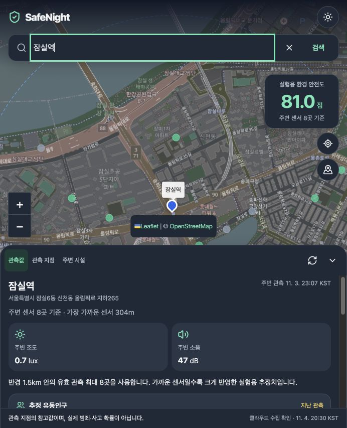
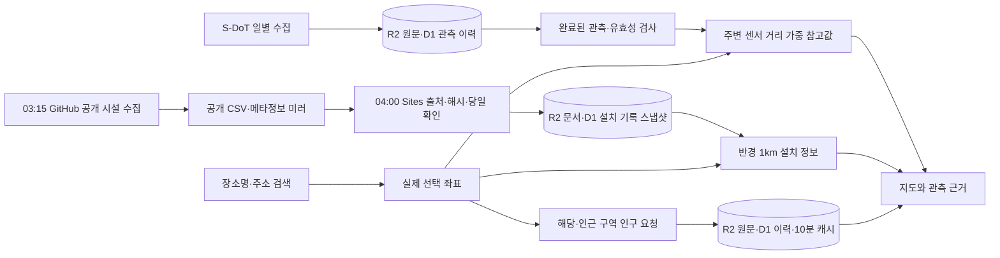

# SafeNight

**환경 안전도의 점수 정의·검증·모델 서빙을 연결하는 지도 서비스**

잠실역·강남역 같은 장소명이나 주소를 검색하면 해당 위치로 지도를 이동하고, 주변의 유효한 S-DoT 관측에 거리 가중치를 적용한 **실험용 환경 안전도**를 보여 줍니다. 조도·소음 외에도 가로등·보안등·CCTV 설치 기록과 서울시 구역 인구 추정치를 함께 확인합니다.

**[스코어링·서빙 체계](docs/scoring-and-serving.md)** · **[사이트 열기](https://safenight-seoul-2026.true-tang-8939.chatgpt.site/)** · **[데이터 출처·갱신 기준](docs/data-sources.md)** · **[실적 설명서](docs/project-achievements.md)** · **[제출용 PDF](output/pdf/SafeNight_실적설명서.pdf)**



*2026-11-04 실제 잠실역 검색 화면. 시설별 기준일과 출처는 앱에서 펼쳐 확인할 수 있습니다.*

현재 사이트는 소유자의 ChatGPT 계정으로 접속합니다. 점수는 기존에 계산한 `safety_index`를 학습한 실험 결과입니다. 실제 범죄·사고 확률이나 보행 안전을 보장하지 않습니다.

## 이 프로젝트의 핵심: 점수 기준에서 제공 조건까지

원래 환경 안전도는 **조도·소음·소음 변동·CCTV·가로등·보안등**을 조합한 규칙 지표입니다. 데이터를 지도에 표시하는 데서 나아가, 어떤 항목을 점수로 만들고 어떤 관측에 모델을 적용할 수 있는지 정하는 것이 프로젝트의 핵심입니다.

| 단계 | 정한 체계 | 현재 구현 |
|---|---|---|
| 스코어링 | 환경 부담과 시설 보완을 합친 기준 정의 | 기존 전체 요소의 규칙 점수 `rule_index`를 학습 목표로 보존 |
| 학습·평가 | 입력·목표·평가 분리를 명시 | 현재 RF는 조도·소음 두 입력으로 기존 지수를 근사하는 임시 모델 |
| 모델 서빙 | 유효한 관측에 검증한 모델만 적용 | 파일·버전·관측 신선도·지원 센서·좌표·입력 범위 검사 |
| 산출 보류 | 근거 부족을 낮은 점수와 구분 | 결측·30시간 초과·지원 범위 밖이면 `score: null`과 사유 |
| 장소 평가 | 주변 관측을 정해진 공간 기준으로 결합 | 반경 1.5km, 최대 8개 유효 센서 점수의 거리 가중 평균 |
| 주변 정보 | 시설·인구의 출처와 범위를 함께 제시 | 현재 조회한 시설·인구는 별도 표시하며 점수에는 미합산 |

**원래 점수식의 구성요소와 현재 모델의 예측 입력은 다릅니다.** 소음 변동·시설은 원래 목표식에 포함되지만 현재 요청의 RF 입력에는 아직 연결되지 않았습니다. 전체 식·가중치·현재 평가값·서빙 조건·Python 코드 읽기 경계는 [스코어링·서빙 체계](docs/scoring-and-serving.md)에 정리했습니다.

## 검색한 위치에 표시하는 정보

| 정보 | 계산·표시 기준 |
|---|---|
| 장소·주소 | Photon / OpenStreetMap에서 검색한 실제 좌표와 주소. Enter 또는 검색 버튼으로 제출 |
| 실험용 환경 안전도 | 반경 1.5km 이내 유효 센서 중 가까운 최대 8개의 기존 추론 점수를 거리 역제곱으로 가중 평균 |
| 조도·소음 | 같은 센서의 관측값과 관측 시각 범위, 사용한 센서 개수·거리 |
| 가로등·보안등·CCTV | 반경 1km의 공개 설치 기록. 현재 송파구·서초구 자료만 확보 |
| 구역 인구 | 서울시 공식 집계 구역의 추정 범위·혼잡도·관측 시각. 위치와 구역의 관계를 별도 표시 |

검색한 좌표를 가장 가까운 센서 위치로 바꾸지 않습니다. 장소 점수는 주변 센서의 참고값을 공간적으로 합친 결과이며, 새 좌표를 모델에 직접 입력한 예측과 구분합니다. 유효한 관측이 없거나 오래된 자료·지원 범위 밖이면 숫자를 만들지 않습니다.

CCTV는 **설치 위치와 공개된 카메라 대수**만 다룹니다. 영상 재생, 카메라 IP·작동 상태 확인, 인원 검출 기능은 제공하지 않습니다. 가로등·보안등 기록도 현재 점등 상태나 실측 밝기를 뜻하지 않습니다.

## 현재 점수와 추가 데이터의 관계

현재 RandomForest의 입력은 **조도(`lux`)와 소음(`noise_db`) 두 가지**입니다. 시설·구역 인구는 지도에서 함께 읽는 주변 정보이며, 현재 점수를 올리거나 내리는 가중치로 넣지 않았습니다. API의 `score_included: false`도 이 구분을 나타냅니다.

사용자가 선택한 다음 단계는 **자료를 누적·검증한 뒤 새 모델을 학습하는 방식**입니다. 시공간 결합과 결측·기준일·대표성을 확인하고, 목표값과 독립 평가 자료를 정한 다음 새 후보를 학습·비교합니다. 검증 전의 추가 입력을 기존 모델에 임의로 끼워 넣거나 새 관측마다 자동 재학습하지 않습니다. 교체 경계는 [모델 교체 안내](docs/model-replacement.md)에 있습니다.

## 수집·갱신 주기

원천 제공기관의 갱신 주기와 SafeNight가 자료를 확인하는 주기는 다릅니다.

| 자료 | 원천의 시간 기준 | SafeNight 처리 |
|---|---|---|
| S-DoT 환경 관측 | 공식 1시간 단위 집계. 지연·보정 자료가 나중에 추가될 수 있음 | 기존 매일 **03:00 Asia/Seoul** 일정으로 전날·누락 구간 수집, 최근 7일 정정 재검사 |
| CCTV·가로등·보안등 | 제공기관의 수시 갱신. 정확한 반영 시각은 공개되지 않음 | 매일 **03:15 KST GitHub Actions** 공개 원천 수집 → **04:00 KST Sites** 검증·DB 반영. 두 일정 등록 완료 |
| 구역 인구 | 공식 약 5분 단위 추정 자료 | 검색·위치 조회 시 해당 구역 요청, **10분 캐시**와 원문·관측 이력 보존 |
| 센서 위치·인구 구역 경계 | 공개 파일의 기준일·배포일 | 새 파일을 별도 검증해 적재 |

시설 자료를 매일 확인하더라도 제공기관의 기준일이 매일 바뀌는 것은 아닙니다. 파일 변경이 없으면 현재 설치 기록을 유지하고, 확인 시각과 원천 기준일을 구분합니다. 2026-11-04 실제 GitHub 수집과 운영 DB 반영을 확인했습니다. 첫 Sites 예약은 2026-11-05 04:00 KST이며, 미래 예약 실행의 성공을 미리 뜻하지는 않습니다. [운영 검증 기록](backend/VALIDATION.md)에 실행 결과를 남깁니다.

인구는 전체 121구역을 정기적으로 전수 수집하는 방식이 아닙니다. 선택한 위치가 구역 안에 있으면 해당 구역을, 구역 밖이면 실제 경계까지 250m 이내인 인근 구역만 **주변 구역 참고값**으로 표시합니다. 원천 관측이 30분을 넘기거나 대체 자료·실패 후 과거 자료이면 `STALE`로 구분합니다. 이는 분당 통과 인원이나 선택 지점의 실제 인원수가 아닙니다.

## 데이터가 화면에 도달하는 과정



S-DoT는 한 요청에 최대 200행 한 페이지를 처리하고, 전체 페이지 검증 전에는 부분 자료를 현재값으로 게시하지 않습니다. 시설 갱신도 같은 manifest에 고정된 네 원천의 SHA-256·출처·한국 날짜를 모두 검증한 작업만 현재 스냅샷으로 바꿉니다. 수집 실패나 당일 자료 미확보 시에는 이전 정상 자료를 유지합니다. 인구는 원문 보존과 관측 저장이 성공한 결과를 응답합니다. 중단·실패·정정과 이전 자료를 추적할 수 있도록 보존합니다.

## 개발과 문서

| 경로 | 내용 |
|---|---|
| [`cloud/`](cloud/README.md) | 현재 확장 대상 Sites 실행본: 지도·검색·API·수집·D1/R2·추론 |
| [`backend/`](backend/README.md) | 개발·재현용 Python 서버와 PostgreSQL |
| [`work/safenight/`](work/safenight/README.md) | 로컬 React 지도 화면. Sites 기능과 버전을 구분 |
| [데이터 출처](docs/data-sources.md) | 항목·기준일·부분 커버리지·원천 갱신과 앱 수집 주기 |
| [검증 기록](backend/VALIDATION.md) | 시험·실수집·배포·일정 등록 결과 |

```sh
cd cloud
npm ci
npx tsc --noEmit
node --test tests/*.test.mjs
npm run build
```

운영은 Sites / Cloudflare Workers·D1·R2에서 실행하며 Docker를 켜 둘 필요가 없습니다. API 키·운영 토큰·DB 비밀번호와 DB 덤프는 공개 저장소에서 제외합니다.

2026-11-04 클라우드 시험 **179개**, 타입 검사·Worker 빌드와 원격 cloud·frontend CI를 통과했습니다. [실제 시설 수집](https://github.com/roberYM11/safenight/actions/runs/41836099458)은 네 원천의 문서 12개·설치 기록 30,332개를 검증했고, Sites 운영 DB에도 네 단계 반영을 완료했습니다. 자료가 같아 기존 스냅샷은 유지하고 확인 시각만 갱신했습니다. 기존 Python CI의 DB 드라이버·시간대 의존 시험도 수정해 원격 시험 77개를 통과했습니다. 상세 결과는 [검증 기록](backend/VALIDATION.md)을 따릅니다.
