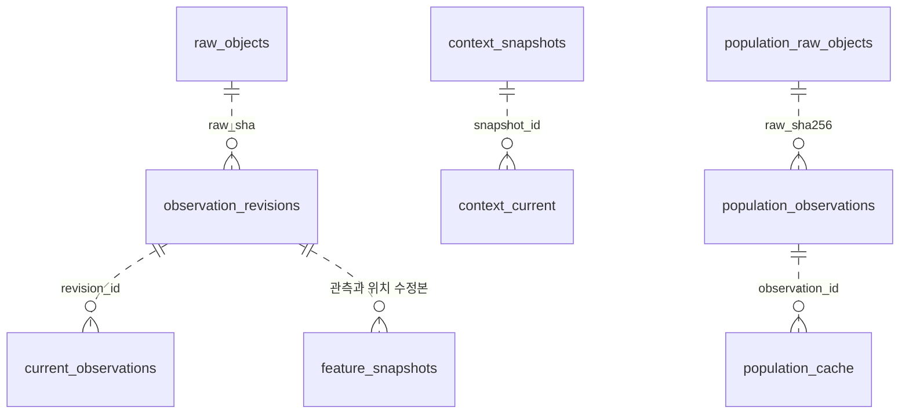
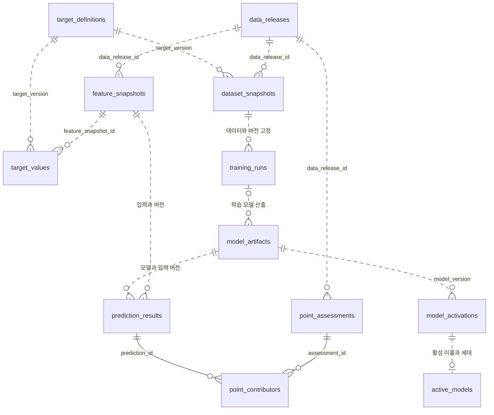
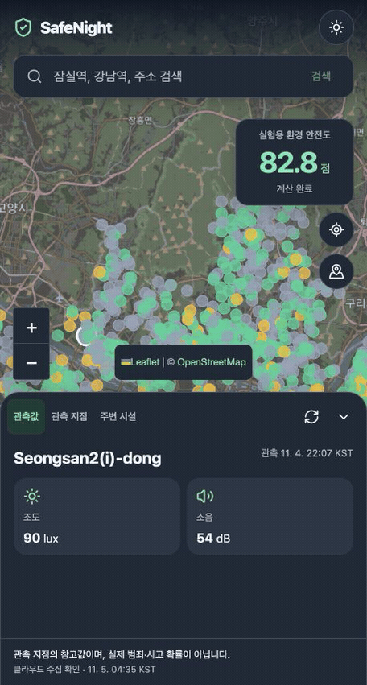
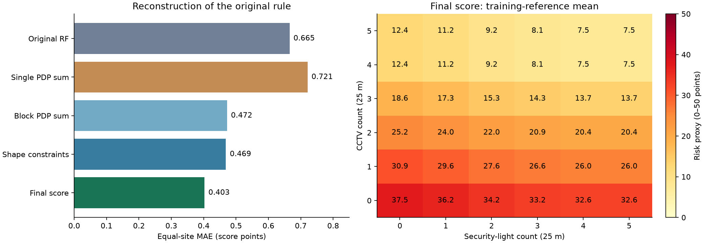
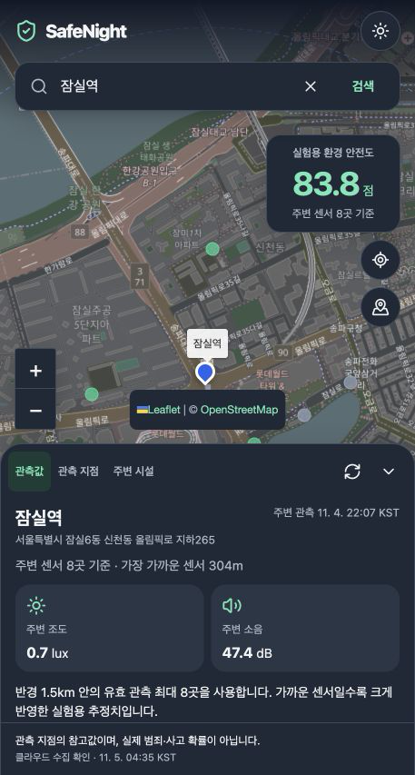

# SafeNight

서울시 야간 조도·소음과 주변 시설·인구를 모은 지도 서비스.

[사이트](https://safenight-seoul-2026.true-tang-8939.chatgpt.site/) · [데이터 출처](docs/data-sources.md)

## 1. 분석의 취지

통계청의 2024년 사회조사에서 전국 13세 이상 인구의 30.5%가 밤에 혼자 걸을 때 불안을 느꼈다. 야간 환경을 함께 살펴볼 수 있도록 센서 관측과 주변 정보를 연결한 지도를 만들었다. [통계청 자료](https://sri.kostat.go.kr/boardDownload.es?bid=219&list_no=433638&seq=8)

## 2. 파이프라인과 사이트 사용 영상

수집한 원본은 R2에, 관측 이력과 데이터·모델 버전은 D1에 저장했다. 수집 중단 후 재개, 학습 데이터 고정, 후보 모델 검증·승인과 예측 결과 저장을 연결했다. 추가한 정기 수집 코드는 아직 운영 배포하지 않았다.

### 수집·조회

[](docs/assets/pipeline-collection.png)



### 학습·모델 교체

[](docs/assets/pipeline-training.png)



정답이 등록된 데이터로 후보를 학습하고, 검증을 통과한 모델만 명시적 승인 후 전환하도록 구현했다. [상세 ERD](docs/database-structure.md) · [운영 안내](cloud/README.md)



[시연 영상 MP4](docs/assets/safenight-demo.mp4)

## 3. 분석 노트북과 결과

[① 데이터 병합](notebooks/safenight-data-integration.ipynb)에서 2026-11-03 관측과 센서 위치를 연결해 야간 관측 3,834행·947센서를 정리했다. CCTV는 위치별로 집계하고, 미확보 조명 자료는 결측으로 남겼다.

[② RF·블록 PDP 연구](notebooks/safenight-pdp-score-research.ipynb)에서 2025-10-12 자료 3,713행을 좌표별 학습·보정·평가로 나눴다. 평가 135좌표·743행에서 기존 규칙식의 재현 오차를 비교했다.

| 방법 | MAE(점) | RMSE(점) |
|---|---:|---:|
| 기존 RF | 0.6654 | 1.2498 |
| 변수별 PDP 합 | 0.7211 | 1.2224 |
| 블록 PDP 합 | 0.4723 | 0.8617 |
| 블록 PDP·시설 제약·계수 보정 | **0.4025** | **0.8025** |

변수별 PDP를 단순히 더하면 오차가 커졌다. 관련 변수를 묶고 시설 제약과 계수 보정을 적용해 RF 대비 MAE를 39.5% 줄였다. 시설 수를 늘리는 모의 비교 17,089쌍에서 점수 역전은 1,263건에서 0건으로 줄었다.



하루 자료의 규칙식 재현 결과이며 실제 안전 예측력은 검증하지 않았다. 중복·좌표 오류를 유지한 원자료와 보정 표본의 한계는 [검증 기록](notebooks/README.md)에 남겼다.

## 4. 스코어링 방법과 검증

조도·소음을 각각 블록으로 묶고, 시설 수가 늘어날 때 위험점수가 증가하지 않도록 PDP 곡선을 보정했다. 가중치는 학습·평가와 분리한 보정 좌표에서 추정했다.

```text
위험 대용점수 R = clip(절편 + Σ 비음수 가중치 × 보정한 블록 PDP 성분, 0, 50)
환경 참고점수 = 100 − R
```

[산식·가정](docs/scoring-and-serving.md)

사이트에는 조도·소음 2입력 RF를 적용하고 시설·인구는 참고 정보로 표시했다. 블록 PDP 연구 점수는 사이트에 적용하지 않았다. 사이트 RF는 중앙값 기준보다 오차가 커 개선 과제로 남겼다. [서비스 모델 평가](docs/model-analysis/metrics.json)

## 5. UI



장소를 검색하면 조도·소음·관측 시각과 주변 시설·인구를 표시하도록 만들었다. 지점 점수에 사용한 센서·거리·반영 비중을 함께 보여 주고, 오래된 관측·입력 부족·지원 범위 밖에서는 점수 대신 보류 사유를 표시했다.

[구현·검증 기록](docs/evidence/final-checks.txt)
