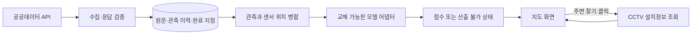

# SafeNight

밤길 주변의 환경정보를 지도에서 확인하는 웹서비스입니다. 서울시 S-DoT의 조도·소음 관측과 센서 위치를 연결하고, 지점을 선택하면 관측값과 주변 CCTV 설치정보를 보여 줍니다.

현재 점수는 **실험용 환경 안전도**입니다. 실제 범죄·사고 확률이나 보행 안전을 보장하는 값은 아닙니다. 공공 영상 API는 승인 대기 중이며, 실시간 영상과 보행자 인원 집계는 아직 연결하지 않았습니다.

## 시작하기

Docker Engine과 Docker Compose 2.24 이상이 필요합니다. 저장소를 내려받은 뒤 다음을 실행합니다.

```sh
git clone https://github.com/roberYM11/safenight.git
cd safenight
cp backend/.env.example backend/.env
# backend/.env에 발급받은 S-DoT·행안부 CCTV 키를 입력합니다.
chmod 600 backend/.env
sh scripts/docker-local.sh
```

사이트는 [localhost:8001](http://localhost:8001/), 개발자용 API 문서는 [localhost:8001/docs](http://localhost:8001/docs)에서 열립니다. 기존 `.env`가 있으면 복사 명령을 생략합니다. 키와 DB는 GitHub에 포함하지 않습니다.

새 DB에서는 센서 위치와 관측을 먼저 수집합니다. 아래 날짜는 예시이므로 제공 기간 안의 날짜로 바꿉니다.

```sh
sh scripts/docker-local.sh exec api safenight download-locations
sh scripts/docker-local.sh exec api safenight collect sdot --day 2026-11-03
```

주변 CCTV 설치정보는 사용자가 **주변 CCTV 찾기**를 누를 때 행안부 API로 조회합니다. 영상 API 승인을 기다리는 동안에도 설치 위치·거리는 확인할 수 있습니다. 원천 응답이나 관측이 없으면 가짜 값으로 채우지 않습니다.

매일 03:00 한국시간의 수집을 켜려면 별도 스케줄러를 실행합니다.

```sh
sh scripts/docker-local.sh --profile collection up -d scheduler
```

수집과 모델 학습은 독립적입니다. 새 관측이 들어와도 모델을 자동으로 다시 학습하지 않습니다. 자세한 설치·종료·볼륨 보존 방법은 [Docker 실행 안내](docs/docker.md)를 참고하세요.

## 사용 흐름과 현재 구현

지도에서 관측 지점을 선택하거나 지역을 검색합니다. 선택한 지점의 조도·소음과 관측 시각을 확인하고, 필요할 때 주변 CCTV 설치정보를 조회합니다. 현재 검색은 센서와 지역명 검색이며, 임의 주소의 안전도를 계산하는 기능은 아직 제공하지 않습니다.

| 기능 | 상태 |
|---|---|
| 지도·센서/지역 검색·밝은/어두운 화면 | 구현 |
| S-DoT 관측·공개 센서 위치 수집과 DB 저장 | 구현 |
| 일별 수집·중복 제거·정정 이력·실패 복구 | 구현, 별도 스케줄러 실행 필요 |
| 주변 CCTV 설치 위치·거리 조회 | 구현, 버튼을 누를 때 실행 |
| 실험용 점수 표시·자료 부족 시 산출 보류 | 구현 |
| 주변 CCTV 영상 | API 승인 대기, 승인된 소스 연결 필요 |
| 실시간 보행자 수 집계 | 미구현 |
| 임의 주소의 거리 가중 안전도·기관 전화·안전 경로·실제 SOS 전송 | 미구현 |



## 개발과 모델 교체

프런트엔드는 `work/safenight`, 수집·DB·서버는 `backend`에 있습니다. 기존 GitHub 화면 파일은 프런트엔드 폴더로 옮겨 보존했습니다. 이전 시연용 SOS·영상·고정 점수 화면은 현재 앱의 실행 경로에서 사용하지 않습니다.

```sh
# 터미널 1: 백엔드 개발 환경
cd backend
uv sync --locked
uv run safenight serve

# 터미널 2: 프런트엔드 개발 서버
cd work/safenight
npm ci
npm run dev
```

위 개발 서버는 설정된 PostgreSQL과 준비된 모델을 사용합니다. Docker DB는 컨테이너 내부 전용입니다. 네이티브 실행을 선택하면 [백엔드 안내](backend/README.md)에 따라 별도의 로컬 DB를 준비합니다.

모델 교체 경계와 입력·출력 계약은 [모델 교체 안내](docs/model-replacement.md)에 정리했습니다. 같은 입력·출력 계약을 유지하면 화면·수집·DB 코드를 고치지 않고 모델 어댑터를 교체할 수 있습니다. 새 입력 변수를 요구하는 모델은 해당 원천 수집과 feature 정의도 추가해야 합니다.

## 문서와 검증

- [프로젝트 실적 설명서 — 모델 내용 제외](docs/project-achievements.md)
- [백엔드 구조·수집·API](backend/README.md)
- [Docker 실행](docs/docker.md)
- [영상 API 승인 후 연결](docs/video.md)
- [모델 교체](docs/model-replacement.md)
- [실행 검증 기록](backend/VALIDATION.md)

GitHub Actions는 프런트엔드 타입 검사·빌드와 백엔드 정적 검사·실제 PostgreSQL을 사용하는 fixture 테스트를 실행합니다. 모델의 현실 안전 예측력과 운영 성능은 별도 검증 대상입니다.
