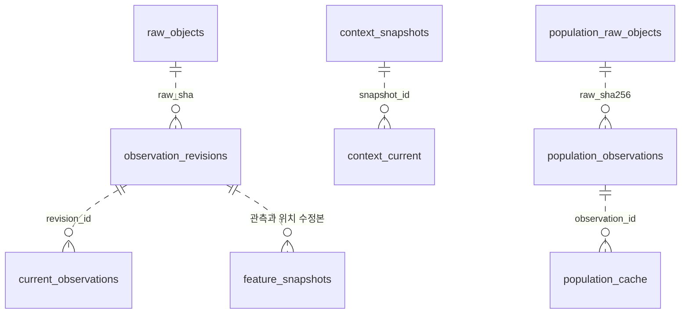
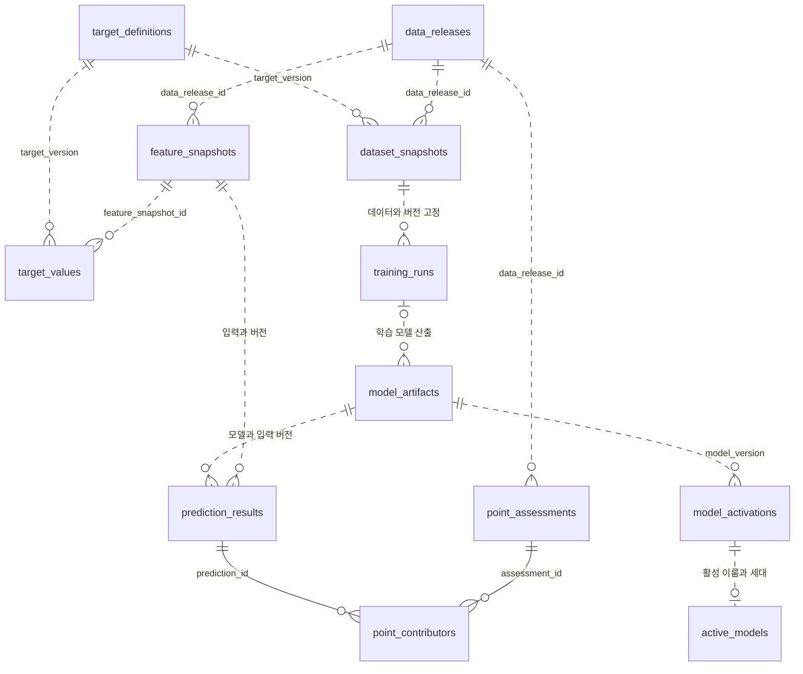

# SafeNight

서울에서 장소를 검색하면 주변 센서가 측정한 밝기와 소음을 보여 주는 지도. [14초 시연 영상](docs/assets/safenight-demo.mp4) · [사이트 열기 (접근 권한 필요)](https://safenight-seoul-2026.true-tang-8939.chatgpt.site/)

## 1. 분석의 취지

통계청의 2024년 사회조사에서 전국 13세 이상 인구의 30.5%가 밤에 혼자 걸을 때 불안을 느낀다고 답했다. 밤에 갈 곳의 주변이 얼마나 밝고 언제 측정한 값인지 미리 볼 수 있도록, 서울시 센서 관측과 공공시설 설치 기록을 지도에 연결했다. [2024년 사회조사](https://sri.kostat.go.kr/boardDownload.es?bid=219&list_no=433638&seq=8) · [데이터 출처](docs/data-sources.md)

## 2. 파이프라인과 사이트 사용 영상

### 수집한 자료가 지도에 표시되기까지

센서 관측·설치 위치 파일의 원본은 R2에 보관하고, 센서 ID와 시각을 기준으로 D1에서 관측값에 좌표를 연결했다. 서울시가 값을 정정하면 이전 기록을 보관하고 지도에는 검증을 마친 최신값을 표시한다.

[](docs/assets/pipeline-collection.png)

<details>
<summary>수집·조회 테이블 관계 (ERD)</summary>



</details>

### 학습 데이터에서 새 모델까지

학습에 쓴 관측값과 목표 점수의 버전을 함께 저장했다. 새 모델은 센서·날짜·지역을 나눠 평가하고, 기준을 통과한 모델을 운영자가 승인해 전환하면 센서 점수를 다시 계산한다. 이 교체 과정과 새 정기 수집 작업은 로컬에서 검증했다. 운영 배포는 다음 단계다. [전체 DB 구조](docs/database-structure.md) · [운영 안내](cloud/README.md)

[](docs/assets/pipeline-training.png)

<details>
<summary>학습·모델 교체 테이블 관계 (ERD)</summary>



</details>

### 잠실역 검색 시연


[시연 영상 MP4](docs/assets/safenight-demo.mp4)

## 3. 분석 노트북과 결과

**데이터 병합.** 2026년 11월 3일 야간 관측 5,233건에서 좌표와 조도·소음 값이 모두 있는 3,834건을 남겼다. 센서 947곳을 기준으로 반경 25m 안의 CCTV 설치 기록 수를 셌다. CCTV는 2022년 자료를 썼고, 확보하지 못한 조명 자료는 빈값으로 남겼다. [데이터 병합 노트북](notebooks/safenight-data-integration.ipynb)

**랜덤 포레스트와 PDP.** 점수 검증에는 별도로 2025년 10월 12일 관측 3,713건을 썼다. 기존 점수식에서는 주변 시설 수가 늘면 위험점수가 낮아지거나 같아진다. 이 식을 학습한 랜덤 포레스트(RF)도 같은 경향을 보이는지 확인했다. 시설 수처럼 한 조건을 바꿔 가며 모델의 평균 예측값을 그린 것이 부분의존도(PDP) 곡선이다. [RF·PDP 분석 노트북](notebooks/safenight-pdp-score-research.ipynb)

| 기존 점수식을 재현한 방법 | 평균 절대 오차(점) |
|---|---:|
| 랜덤 포레스트 | 0.6654 |
| 변수별 PDP 곡선을 따로 계산해 더한 점수 | 0.7211 |
| 조도끼리, 소음끼리 묶어 계산한 점수 | 0.4723 |
| 시설 곡선과 가중치까지 보정한 점수 | **0.4025** |

학습과 보정에서 빼 둔 135곳의 관측 743건에서 최종 점수식의 오차는 기존 RF보다 **39.5% 작았다**. 시설 수만 늘려 비교한 17,089쌍 중 위험점수가 오른 경우는 1,263건에서 0건으로 줄었다. [결과 그래프](docs/notebook-results/core-results.png)

## 4. 점수를 계산한 방법과 근거

### 연구용 위험점수

조도의 최솟값·평균·최댓값은 같은 센서가 한 시간 동안 측정한 값이다. 하나만 바꾸면 최솟값이 평균보다 높아질 수도 있어 세 값을 함께 바꿨다. 소음도 같은 방식으로 묶었다. CCTV·가로등·보안등은 시설 수가 늘 때 위험점수가 오르지 않도록 곡선을 보정했다.

```math
R_{\mathrm{new}}(x)
= \mathrm{clip}_{[0,50]}\!\left[
  \alpha + \sum_{B} w_B\,\widetilde{P}_B(x_B)
\right],
\qquad w_B \ge 0
```

다섯 묶음에서 구한 점수 기여분 $\widetilde{P}_B(x_B)$에 가중치 $w_B$를 곱해 더하고, 절편 $\alpha$를 더한 값을 0~50점으로 제한했다. 가중치는 따로 남겨 둔 134곳에서 맞췄다. [산식과 가중치](docs/scoring-and-serving.md)

### 지도에 표시하는 참고점수

지도에서는 평균 조도와 평균 소음으로 각 센서의 점수를 추정하고, 검색 지점에 가까운 센서에 더 큰 비중을 줬다. 이 두 값으로 학습한 RF는 트리의 말단에 필요한 최소 표본을 3개에서 1개로 줄이자 오차가 8.28점에서 8.47점으로 커졌다. 두 경우 모두 학습 자료의 중앙값을 일괄 적용한 오차(7.95점)보다 컸다. [지도 모델의 평가 결과](docs/model-analysis/metrics.json)

## 5. 지도에서 볼 수 있는 정보

시연에서 잠실역을 검색했을 때 가장 가까운 센서는 304m 떨어져 있었다. 화면에서 주변 센서 8곳의 거리와 측정 시각, 각 센서가 점수에 반영된 비중을 확인할 수 있다. 30시간이 지난 관측은 계산에서 뺀다. 반경 1.5km 안에 점수를 낼 수 있는 센서가 없으면 보류 사유를 표시한다. 주변 시설과 구역별 인구에는 각각 자료의 기준 시각이나 날짜를 붙였다.


