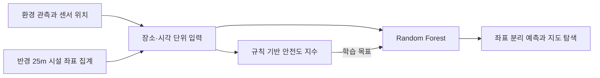

# SafeNight

밤길의 밝기·소음과 주변 안전시설을 연결해, 장소와 시간에 따른 안전도를 예측하는 프로젝트입니다.

[로컬 사이트](http://127.0.0.1:8765) · 서울 공개 자료와 센서 관측을 결합한 포트폴리오 프로젝트입니다.


## 왜 만들었는가

밤길을 걸을 때는 지금 지나갈 곳이 안전할지 미리 알고 싶어집니다. SafeNight은 그런 불안을 느끼는 사람이 주변 환경을 판단할 때 참고할 정보를 제공하려고 만들었습니다.

이 문제를 데이터로 다루려면 먼저 ‘어디가 안전한가’라는 질문을 구체화해야 했습니다. CCTV와 조명이 어디에 있는지에 더해, 그 시간에 실제로 얼마나 밝았는지, 주변 소음은 어땠는지도 함께 볼 수 있다고 생각했습니다. 시설의 위치와 시간에 따라 달라지는 환경을 연결하는 것이 SafeNight의 중심 아이디어입니다.

## 시설 위치에 시간의 변화를 더하다

시설 좌표는 한 장소 주변에 어떤 지원이 있는지 보여줍니다. 센서값은 그 장소가 특정 시각에 어떤 환경이었는지 기록합니다. 서로 다른 자료를 센서 위치에서 겹치면, 같은 장소도 시간에 따라 다르게 설명할 수 있습니다.

그래서 분석 단위를 **센서 한 곳의 특정 시각 관측**으로 정했습니다. 센서 ID로 환경 관측과 설치 위치를 연결하고, 위도·경도를 거리로 바꿔 반경 25m 안의 시설 좌표 행을 집계했습니다. 25m는 원래 프로젝트에서 정한 탐색 반경이며, 시야나 조명 도달 거리를 실측한 값과는 구분해 기록했습니다.

여기서 사용한 Haversine 거리는 지구를 평면으로 보지 않고 구면으로 근사해 두 위도·경도 사이의 거리를 계산하는 방법입니다. 위도 차이와 경도 차이를 라디안으로 바꾼 뒤, 위도에 따른 경도 간격 차이까지 반영해 두 지점 사이의 최단 표면 거리를 구합니다. 서울처럼 비교적 좁은 범위에서도 위도·경도를 단순히 빼는 것보다 실제 거리(m)에 가까운 값을 얻을 수 있습니다. 계산한 거리는 BallTree가 여러 시설 좌표 중 반경 안의 행을 빠르게 찾는 데 사용됩니다.

| 사용한 자료 | 가져온 정보 | 이 정보를 넣은 이유 |
| --- | --- | --- |
| 서울 S-DoT 환경정보 | 시간별 조도·소음 최대·평균·최소 | 시설 설치 여부와 별개로 관측 시각의 환경을 표현 |
| S-DoT 설치 위치 | 센서 ID, 위도·경도 | 서로 다른 자료를 같은 장소로 연결 |
| 안심이 CCTV 좌표 | 반경 안의 좌표 행 수 | 주변 카메라 설치 지점의 분포를 표현 |
| 가로등 위치 | 반경 안의 좌표 행 수 | 제공 자료에 포함된 주변 가로등 분포를 표현 |
| 원본의 보안등 파일 | 반경 안의 좌표 행 수 | 골목 조명 관련 시설 정보를 보완 |

소음은 주변의 음향 환경을 나타내는 관측값으로 사용했습니다. 유동인구와의 관계는 독립적인 사람 수 관측을 연결해 살펴볼 가설입니다. 가로등 자료는 서울시 도로사업소·서울시설공단 관리 시설을 제공하므로, 집계가 0인 지점도 제공 범위와 함께 읽습니다.



## 안전도 수치화

입력은 조도 3개, 소음 3개, 소음 범위 대리값 1개, 시설 집계 3개로 총 10개입니다. 소음 범위 대리값은 `(최대 소음 - 최소 소음) / 4`입니다. 위도·경도는 공간 결합과 평가 그룹을 만드는 데 사용합니다.

안전도 지수는 조도·소음의 부담과 시설별 보완 점수를 조합해 계산했습니다. 이 값을 Random Forest가 학습할 목표로 사용했습니다.

```text
환경 부담 = 0.30 × 조도 위험 + 0.15 × 소음 위험 + 0.10 × 소음 범위 기반 위험
시설 보완 = 0.25 × CCTV 점수 + 0.15 × 가로등 점수 + 0.05 × 보안등 점수
안전도 지수 = clip(100 - 환경 부담 + 시설 보완, 0, 100)
```

가중치·임계값·반경은 설계 가설로 남겨 두고 [전체 수식](docs/METHOD.md)에 공개했습니다. 이 식은 비음수 입력에서 지수 하한이 50점입니다. 현재 모델은 위 식으로 만든 지수를 예측하며, 결과의 의미는 **설계한 환경 평가 기준에 대한 추정값**입니다. 실제 보행 안전과의 관계는 외부 관측을 더해 확인하는 다음 질문으로 이어집니다.

## 이 데이터에 Random Forest를 사용한 이유

모델 선택은 입력의 형태와 점수의 구조에서 출발했습니다.

**단위가 다른 표 형태의 입력.** 평균 조도는 0~467 lux, 평균 소음은 35~74 dB이고 시설 집계는 정수입니다. 결정나무는 변수별 경계를 기준으로 나누기 때문에, 거리 기반 모델처럼 단위 크기가 거리 계산에 직접 반영되는 문제를 피할 수 있습니다.

**한 직선으로 표현하기 어려운 평가식.** 조도 위험은 300 lux에서 0에 도달하고, 시설별 점수는 상한에 이르면 추가 집계가 점수를 계속 올리지 않습니다. 소음도 구간별 계산식을 사용합니다. 이런 임계값과 포화 구간을 표현할 후보로 나무 기반 회귀를 선택했습니다.

**단일 나무와의 비교.** 한 나무는 표본이 바뀌면 분할 경계가 달라질 수 있습니다. 여러 부트스트랩 표본에서 학습한 나무의 예측을 평균하는 Random Forest를 사용했습니다. 설정은 나무 114개·최대 깊이 18·`max_features=None`입니다. 각 분할에서 전체 10개 변수를 검토하므로, 변수 무작위 선택으로 성능을 설명하지 않았습니다.

이유를 설명하는 데서 그치지 않고, 현재 표본에 동일한 좌표 분리 5-fold를 적용해 네 모델을 비교했습니다. 별도 하이퍼파라미터 탐색은 추가하지 않았습니다.

| 모델 | OOF RMSE | OOF MAE | OOF R² |
| --- | ---: | ---: | ---: |
| 학습 평균값 | 9.4546 | 8.0331 | -0.0048 |
| 선형 회귀 | 7.9327 | 2.8825 | 0.2926 |
| 단일 결정나무 | 1.2337 | 0.4421 | 0.9829 |
| Random Forest | **0.8849** | **0.3505** | **0.9912** |

각 관측은 해당 좌표 전체를 학습에서 제외한 모델로 예측했습니다. OOF는 이 평가 폴드 예측을 모두 모았다는 뜻입니다. 현재 비교에서는 Random Forest의 규칙 재현 오차가 가장 작았습니다. 선형 회귀는 폴드별 RMSE가 3.12~16.36으로 크게 달라졌으며, 폴드별 값도 [실험 결과](results/benchmark.json)에 남겼습니다.

같은 입력으로 이미 수식이 정해져 있으므로, 지수를 정확히 계산할 때의 기준은 수식을 직접 적용한 값입니다. Random Forest 실험은 그 기준을 새로운 좌표에서 얼마나 재현하는지 확인합니다. 모델의 역할을 실제 안전 예측으로 확장하려면 관측된 안전 결과를 목표값으로 연결하는 과정이 필요합니다.

## 데이터 점검

원시 센서 CSV 165,476행의 열 구조를 점검하면서 헤더와 데이터의 폭이 6칸 어긋나는 문제를 확인했습니다. 헤더는 58열이고 데이터는 뒤에 빈 필드 6개를 포함한 64열이었습니다. 이 차이를 바로잡아 조도와 소음의 실제 열을 사용했습니다.

실제 조도·소음 열을 사용한 3,619행을 기준으로 다음 표본을 구성했습니다.

1. 위도·경도가 뒤바뀐 형태의 센서 2곳, 11행을 분석 대상에서 제외했습니다.
2. 남은 동일 센서·시각 반복 378행은 입력이 같은지 확인한 뒤 첫 행을 남겼습니다.
3. 최종 **3,230행·652개 좌표**로 모델을 비교하고 사이트 데이터를 생성했습니다.

시설 집계에서도 해석할 점을 찾았습니다. 보안등 221개로 기록된 사례는 같은 좌표의 행 221개가 집계된 결과였습니다. 현재 실험은 원래 시설 집계를 유지하며, 물리적 설치 수를 확인하려면 시설 ID와 중복 기준을 더 대조할 수 있습니다. CCTV 원본 재확인과 보안등 파일의 정확한 공식 배포 경로도 [데이터 문서](docs/DATA.md)에 남겼습니다.

초기 80:20 행 단위 평가에서는 테스트 743행 모두가 훈련 좌표와 겹쳤습니다. 그래서 최종 비교에서는 좌표별로 폴드를 나눠 다른 장소에 대한 재현 정도를 살폈습니다. 가까운 좌표의 공간적 연관성과 다른 날짜에 대한 검증은 이어서 다룰 질문입니다. 상세 기록은 [검증 문서](docs/PROJECT_EVIDENCE.md)에서 확인할 수 있습니다.

## 사이트에서 확인하기

사이트는 다크 화면을 기본으로 사용합니다. 관측 시간과 센서를 고르면 지도, 예측 지수, 규칙 지수, 조도·소음, 주변 시설 집계가 함께 바뀝니다. `내 위치 사용`을 누르면 브라우저 위치 권한으로 현재 위치를 지도에 표시합니다. 정확히 일치하는 센서가 없는 경우에는 같은 시간대의 가까운 센서 8개를 고르고, 거리의 제곱에 반비례하는 가중치로 예측값과 환경값을 보간합니다. 가까운 센서일수록 영향이 커지고 먼 센서일수록 영향이 작아지는 방식입니다.

```bash
python3 -m http.server 8765 --bind 127.0.0.1 --directory site
```

브라우저에서 [http://127.0.0.1:8765](http://127.0.0.1:8765)를 엽니다. Windows에서는 `python3` 대신 `py`를 사용할 수 있습니다. 관측값·예측값·지도 라이브러리는 저장소에 포함되어 있고, OpenStreetMap 배경 타일은 인터넷으로 불러옵니다.

표본은 **2025-10-12 00:07·01:07·02:07·22:07·23:07**입니다. 같은 날짜의 새벽과 늦은 밤을 선택한 자료입니다. 사이트는 저장된 관측을 보여주며, 서울시 실시간 API 연결은 [복구 메모](docs/API_RECOVERY.md)에 정리했습니다.

## 실행 방법

사이트는 Python 기본 서버만으로 열 수 있습니다. 모델 학습에는 Python 3.12 이상과 [uv](https://docs.astral.sh/uv/)를 사용합니다.

```bash
uv run src/prepare.py data/intermediate/restored_candidates.csv
uv run src/train.py
uv run --with numpy==2.3.5 --with pytest pytest -q
```

`train.py`는 모델 비교 결과, 관측별 OOF 예측 CSV, 사이트용 데이터, 전체 표본으로 학습한 모델을 생성합니다. 사이트의 값은 평가용 OOF 예측이고 `models/random_forest.joblib`은 후속 실험용 전체 학습 모델입니다. 원래 선택한 파라미터를 재사용했으므로 이번 폴드 비교는 진단 결과로 기록했습니다.

| 경로 | 담은 내용 |
| --- | --- |
| `site/` | 실제 실행하는 지도 웹사이트 |
| `src/scoring.py` | 10개 변수와 지수 계산식 |
| `src/prepare.py` | 좌표 검사·반복 관측 정리 |
| `src/train.py` | 좌표 분리 5-fold 비교·모델 저장 |
| `data/processed/` | 최종 입력·예측·좌표 제외 행 |
| `data/intermediate/` | 원시 열을 정리한 3,619행 후보 |
| `results/` | 입력 SHA-256·버전·모델별 수치·기존 감사 기록 |
| `archive/` | 분석 기록·원시 데이터 점검 코드 |
| `docs/` | 출처·수식·복구·검증·작업 계보 |

밤길의 불안을 데이터로 다룰 수 있을지에서 시작해, 서로 다른 자료를 장소와 시간으로 연결하고 그 가정을 다시 점검했습니다. SafeNight의 독창성은 이 질문을 데이터 결합과 검증 가능한 예측 과정으로 구체화한 데 있습니다. 실제 안전 결과와의 연결, 더 긴 관측 기간, 시설 ID 기반 집계는 이 질문을 이어갈 다음 단계입니다.

프로젝트 기록: 2026-10-31. 서울시 공개 자료를 활용한 개인 프로젝트입니다. 데이터 출처와 처리 과정은 [작업 계보](docs/PROVENANCE.md)에 기록했습니다.
