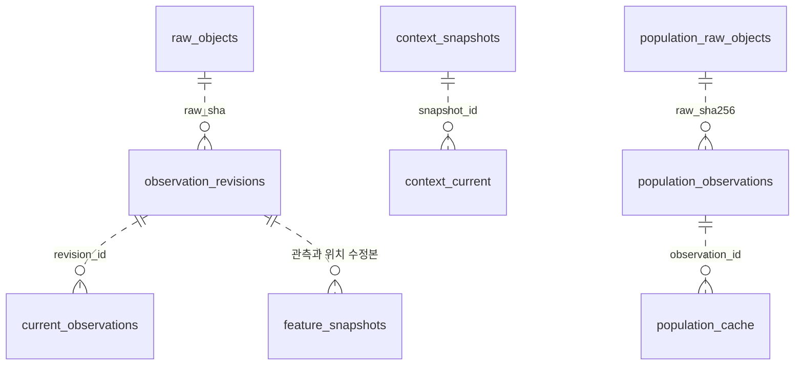
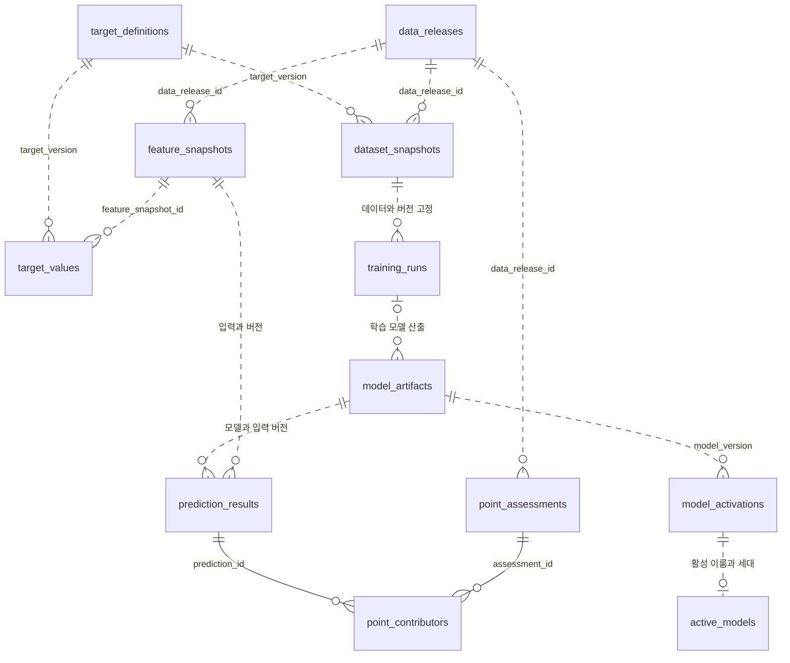

# SafeNight

서울의 밤길을 검색해 주변 센서가 측정한 밝기와 소음을 살펴보는 지도. [사이트 열기](https://safenight-seoul-2026.true-tang-8939.chatgpt.site/)

## 1. 분석의 취지

통계청의 2024년 사회조사에서 전국 13세 이상 인구의 30.5%가 밤에 혼자 걸을 때 불안을 느낀다고 답했다. 밤에 갈 곳을 미리 찾아보는 사람에게 그 주변이 얼마나 밝고, 언제 측정한 값인지 보여 주고 싶었다. 서울시 환경 센서의 관측값에 위치를 붙이고 주변 시설의 설치 기록을 같은 지도에 올렸다. [2024년 사회조사](https://sri.kostat.go.kr/boardDownload.es?bid=219&list_no=433638&seq=8) · [데이터 출처](docs/data-sources.md)

## 2. 파이프라인과 사이트 사용 영상

### 수집한 자료가 지도에 표시되기까지

원본 파일은 R2에 저장하고, D1에는 센서별 관측 시각과 수정 이력을 남겼다. 서울시가 관측값을 정정하면 이전 값도 보관하고 지도에는 최신 수정본을 표시한다.

### 학습 데이터에서 새 모델까지

어떤 자료로 점수를 계산했는지 추적할 수 있도록 학습에 쓴 관측값과 목표 점수의 버전을 함께 저장했다. 새 모델은 별도 자료로 평가하고, 기준을 통과해 승인을 받으면 센서 점수를 다시 계산한다. 모델 교체와 새 정기 수집 작업은 로컬 검증을 마쳤고, 운영 환경에 적용하는 단계가 남아 있다. [전체 DB 구조](docs/database-structure.md) · [운영 안내](cloud/README.md)

### 잠실역 검색 시연

[시연 영상 MP4](docs/assets/safenight-demo.mp4)

## 3. 분석 노트북과 결과

**데이터 병합.** 2026년 11월 3일 야간 관측 5,233건에서 좌표와 조도·소음 값이 모두 있는 3,834건을 남겼다. 센서 947곳에 반경 25m 안의 CCTV 설치 기록을 연결했다. CCTV는 2022년 자료를 사용했고, 확보하지 못한 조명 자료는 빈값으로 두었다. [데이터 병합 노트북](notebooks/safenight-data-integration.ipynb)

**랜덤 포레스트와 PDP.** 기존 점수식에서는 주변 시설 수가 늘면 위험점수가 낮아지거나 같아진다. 이 식을 학습한 랜덤 포레스트(RF)에서도 같은 경향이 나타나는지 2025년 10월 12일 자료 3,713건으로 확인했다. 시설 수처럼 한 조건을 바꿔 가며 모델의 평균 예측값을 그린 것이 부분의존도(PDP) 곡선이다. [RF·PDP 분석 노트북](notebooks/safenight-pdp-score-research.ipynb)

| 기존 점수식을 재현한 방법 | 평균 절대 오차(점) |
|---|---:|
| 랜덤 포레스트 | 0.6654 |
| 변수별 PDP 곡선을 따로 계산해 더한 점수 | 0.7211 |
| 조도끼리, 소음끼리 묶어 계산한 점수 | 0.4723 |
| 시설 곡선과 가중치까지 보정한 점수 | **0.4025** |

학습과 보정에서 빼 둔 135곳의 관측 743건으로 평가했다. 변수를 하나씩 바꾸자 오차가 커졌고, 함께 측정한 값을 묶자 오차가 줄었다. 최종 점수의 오차는 기존 RF보다 **39.5% 작았다**. 시설 수만 늘린 17,089쌍 중 위험점수가 오른 경우도 1,263건에서 0건으로 줄었다.

## 4. 점수를 계산한 방법과 근거

조도의 최솟값·평균·최댓값은 같은 센서가 한 시간 동안 측정한 값이다. 하나만 바꾸면 최솟값이 평균보다 높아질 수도 있어 세 값을 함께 바꿨다. 소음도 같은 방식으로 묶었다. 여기에 CCTV·가로등·보안등 곡선을 하나씩 더하되, 시설 수가 늘 때 위험점수가 오르지 않도록 했다. 다섯 곡선의 가중치는 따로 남겨 둔 134곳에서 맞췄다. 검증한 범위는 하루치 관측에서 기존 점수식을 얼마나 잘 재현하는지까지다. [산식과 가중치](docs/scoring-and-serving.md)

지도에서는 센서가 측정한 평균 조도와 평균 소음으로 참고점수를 계산한다. 이 두 값으로 학습한 RF는 트리의 말단에 필요한 최소 표본을 3개에서 1개로 줄이자 오차가 8.28점에서 8.47점으로 커졌다. 같은 평가에서 학습 자료의 중앙값만 써도 오차는 7.95점이었다. [지도 모델의 평가 결과](docs/model-analysis/metrics.json)

## 5. 지도에서 볼 수 있는 정보

시연에서 잠실역을 검색했을 때 가장 가까운 센서는 304m 떨어져 있었다. 화면에서 주변 센서 8곳의 거리와 측정 시각, 각 센서가 점수에 반영된 비중을 확인할 수 있다. 관측이 30시간을 넘기면 점수 대신 보류 사유를 표시한다. 주변 시설과 구역별 인구에는 각각 자료의 기준 시각이나 날짜를 붙였다.

