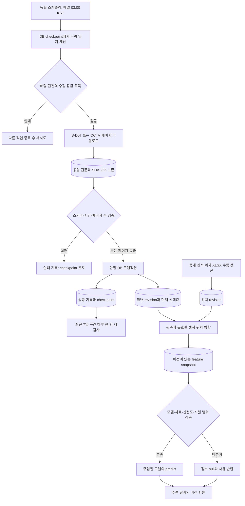

# SafeNight 백엔드

두 API 키로 **S-DoT 환경 관측과 행정안전부 CCTV 정보의 수집·보존·조회 서버를 먼저 만들 수 있습니다.** 센서 좌표는 별도 인증이 필요 없는 서울시 공개 XLSX로 보완했습니다. 가로등·보안등 자료와 검증된 위험도 모델은 별도로 연결해야 합니다.

실제 구현은 `backend/`에 있습니다. 기존 지도 중심 React 화면에 최신 관측과 임시 RandomForest 추론을 연결했습니다. 이 서버는 노트북을 실행하지 않습니다. 현재 모델과 사이트의 실행 방법은 상위 [README](../README.md)에 있습니다.

## 현재 확인한 결과

2026년 11월 4일 로컬 PostgreSQL 16.2에서 확인했습니다.

| 항목 | 확인 결과 |
|---|---|
| S-DoT 2026-11-03 일자 | 응답 29,200행, 중복 제거 후 고유 revision 24,715개 저장 |
| 센서 위치 | 서울시 2026-03-10 공개 파일에서 1,170개 저장 |
| CCTV 2026-11-03 변경 조회 | 인증 및 조회 성공, 해당 변경 구간 응답 0행 |
| CCTV 전체 기준 자료 | 아직 미수집. 변경 0건은 CCTV가 없다는 뜻이 아님 |
| API | 실제 DB에서 관측·센서 좌표 병합·추론 상태 조회 확인 |
| 모델 | 보정한 기존 지수로 학습한 임시 RandomForest, 입력·센서 위치 범위 안에서 추론 |
| 모델 평가 | 센서 분리 평가 MAE 8.2808, R² -0.0211. 실제 안전 정확도가 아님 |
| 검증 | 실제 PostgreSQL 포함 최신 fixture 105개 통과. 상세 결과는 VALIDATION.md에 기록 |

검증 기록은 [VALIDATION.md](VALIDATION.md)를 참고하십시오. 이 결과는 실행·저장·오류 처리 검증입니다. 위험도 정확도나 운영 처리량의 보장 수치가 아닙니다.

## 데이터가 들어오고 사용되는 과정



원문은 현재 PostgreSQL의 `raw_objects`에 저장합니다. 같은 응답 바이트와 같은 정규화 revision은 다시 저장하지 않습니다. 값이 바뀐 revision은 남겨 두고, S-DoT의 `DATA_NO`와 원천 수정 시각에 따라 현재 선택값을 결정합니다. 우선순위를 정할 수 없는 충돌은 배치 전체를 실패 처리합니다.

페이지 누락·반복·총행수 변경·파싱 오류가 있으면 정규화 데이터와 완료 지점을 게시하지 않습니다. 이미 받은 HTTP 200 응답 원문은 유지합니다. HTTP 오류 응답 본문까지 보관하는 구조는 아직 아닙니다. 성공한 배치의 정규화 저장, 현재값 선택, 완료 지점 변경은 한 트랜잭션입니다.

새 데이터의 유입은 재학습을 실행하지 않습니다. 수집·조회·모델 학습과 배포를 분리했으며, 현재 구현에는 자동 학습 작업이 없습니다.

## 생성한 코드

| 위치 | 책임 |
|---|---|
| `src/safenight_backend/ingestion/sdot.py` | S-DoT 요청·단위·시간·정정 구분 검증 |
| `src/safenight_backend/ingestion/cctv.py` | CCTV 전체/변경 조회, 페이지·수정 구간 검증 |
| `src/safenight_backend/ingestion/locations.py` | 공개 센서 좌표 XLSX 검증 |
| `src/safenight_backend/runner.py` | 원천별 동시 수집 방지, 원문 보존, 전체 페이지 수집 |
| `src/safenight_backend/repository.py` | revision 중복 제거·현재값 선택·checkpoint 원자적 저장 |
| `src/safenight_backend/models.py` | 수집 이력·원문·관측·feature·모델 메타데이터 테이블 |
| `src/safenight_backend/migrations.py` | 초기 스키마 v1 생성과 동시 초기화 잠금 |
| `src/safenight_backend/schedule.py` | 일별 수집, 누락 구간 복구, 최근 구간 재검사 |
| `src/safenight_backend/location_import.py` | 위치 파일 원문과 적용 일자가 있는 위치 revision 저장 |
| `src/safenight_backend/features.py` | 센서 관측·위치 병합, 입력 lineage 저장 |
| `src/safenight_backend/serving/` | 모델 어댑터 계약과 점수 제공 조건 검사 |
| `src/safenight_backend/main.py` | FastAPI 조회·feature·추론 상태 API |
| `src/safenight_backend/cli.py` | 서버·수집·위치 적재·스케줄러 실행 명령 |
| `src/safenight_backend/config.py`, `http_client.py`, `db.py` | 비밀 설정, HTTP 제한, DB 연결 |
| `tests/` | 원천 응답, 실제 PostgreSQL, API, 정기 작업, 모델 경계 fixture |
| `scripts/local_postgres.py` | 개발용 로컬 PostgreSQL 실행 |
| 저장소 루트 `Dockerfile`, `compose.yaml` | 화면·API·별도 PostgreSQL·선택적 스케줄러 구성, 실제 실행 검증 |

`model_artifacts`, `active_models`는 향후 모델 배포를 위한 스키마입니다. 현재 RF 파일의 digest 검증은 구현했지만, DB 레지스트리의 승인·자동 로딩·배포 전환은 연결하지 않았습니다. 현재 서버는 신뢰한 코드에서 정한 모델을 로딩합니다. 교체 방법은 [모델 교체 안내](../docs/model-replacement.md)에 있습니다.

## 로컬 실행

Python 3.12와 `uv`를 사용합니다. 아래 명령은 모두 `backend/`에서 실행합니다.

```sh
uv sync --locked
cp .env.example .env
chmod 600 .env
```

새 설치에서만 예제 파일을 복사하십시오. 현재 작업 폴더의 `.env`에는 제공한 두 키와 로컬 DB 연결이 이미 설정되어 있습니다. 키가 있는 `.env`는 Git과 전달 ZIP에서 제외했습니다.

개발용 DB를 별도 터미널에서 실행합니다.

```sh
uv run scripts/local_postgres.py
```

출력된 Unix socket 연결 주소를 `.env`의 `SAFENIGHT_DATABASE_URL`에 넣습니다. 이 개발 DB는 로컬 socket과 trust 인증을 사용합니다. 운영 DB에는 별도의 인증·백업·복구 설정이 필요합니다.

```sh
uv run safenight migrate
uv run safenight download-locations
uv run safenight collect sdot --day 2026-11-03
uv run safenight collect cctv --day 2026-11-03
uv run scripts/train_random_forest.py
uv run safenight serve
```

서버는 기본적으로 `127.0.0.1:8000`에서 실행됩니다. API 문서는 [로컬 Swagger](http://127.0.0.1:8000/docs)에서 확인합니다.

| API | 응답 |
|---|---|
| `GET /health/live` | 프로세스 상태 |
| `GET /health/ready` | DB 연결과 실제 로딩된 모델 유무 |
| `GET /sources` | 원천 설정, 최근 성공/실패, 수집 경계, 전체 기준 자료 유무 |
| `GET /observations?source=sdot&limit=20` | 현재 선택된 관측 revision |
| `GET /features/{sensor_id}` | 관측과 센서 좌표를 병합한 입력, 입력 버전 |
| `GET /assessments/{sensor_id}` | nullable 점수, 사유, 관측·모델·입력 버전 |
| `GET /map` | 센서별 최신 관측·좌표·추론을 일괄 조회 |

위 API는 `/api` 접두어로도 제공합니다. `SAFENIGHT_WEB_DIST`를 설정하면 빌드된 사이트를 같은 서버의 `/`에서 제공합니다.

관측 조회의 좌표는 원천 그대로이며 S-DoT에서는 null입니다. 좌표 병합 결과는 feature API에서 확인합니다. feature 및 assessment 조회는 같은 입력을 해시로 중복 제거하여 feature snapshot을 기록할 수 있습니다. 외부 수집을 실행하거나 모델을 업로드하는 HTTP API는 열지 않았습니다.

## 주기적 수집

```sh
uv run safenight schedule
# 현재 시각에 필요한 작업만 한 번 실행하려면:
uv run safenight schedule --once
```

기본 실행 시각은 매일 **03:00 KST**, 대상은 완료된 전날입니다. 원천별 완료 지점을 DB에 보존하므로 프로세스를 다시 켜면 누락된 날짜부터 순서대로 수집합니다. 최근 7일을 하루 한 번 재조회하여 늦은 공개·정정을 반영합니다. 실패한 원천은 15분 뒤 재시도하고 다른 원천의 작업은 진행할 수 있습니다. 29일을 넘는 공백은 임의로 건너뛰지 않고 `archive_backfill_required`를 반환합니다.

현재 네이티브 DB·API와 Docker의 DB·API를 각각 실행해 확인했습니다. Docker 실행에는 저장소 루트의 [안내](../docs/docker.md)를 사용합니다. **스케줄러의 OS 자동 시작·상시 실행은 등록하지 않았습니다.** 위 프로세스가 실행 중이어야 정기 수집이 동작합니다. Mac이 꺼져 있는 동안의 자동 실행을 보장하지 않습니다.

CCTV는 먼저 전체 기준 자료가 필요합니다. 전체 수집을 실행하려면 실제 실행 당일의 KST 일자로 다음 명령을 사용합니다. 전국 자료이므로 페이지 수·실행 시간·승인된 일일 호출량을 확인해야 합니다.

```sh
uv run safenight collect cctv --day YYYY-MM-DD --full-snapshot
```

변경 조회의 0행을 주변 CCTV 0대로 치환하지 않습니다. 현재 `cctv_count`는 null입니다. 전체 기준 자료, 삭제 코드 해석, 미터 단위 공간 집계 정책을 완성한 뒤 해당 feature를 연결해야 합니다.

전체 기준 자료와 센서 위치 snapshot은 일별 변경 수집의 checkpoint를 전진시키지 않습니다. 새 기준 파일을 가져온 사실이 중간 날짜의 변경 이력을 모두 수집했다는 뜻은 아니기 때문입니다.

## 다음 모델을 연결하는 경계

일반 서버와 Docker 모두 `model_runtime.py`의 `load_model()`에서 한 번 모델을 읽습니다. `RuntimeAdapter`가 지도·개별 평가 API의 공통 경계이며, 새 `Predictor`는 `AssessmentService`와 `ServiceRuntime`으로 감쌀 수 있습니다. 직접 서비스 주입도 시험을 위해 유지합니다. [모델 교체 안내](../docs/model-replacement.md)에 계약과 명령을 정리했습니다.

일반 기본 정책은 30시간 이내의 관측과 조도·소음·CCTV 수를 요구하고, 지원 센서 집합은 비어 있습니다. 현재 임시 RF는 별도 정책으로 조도·소음·센서 ID·좌표를 검사하고, 시설 개수는 입력에 사용하지 않습니다. 모델은 로컬 JSON artifact를 명시적으로 로딩합니다. 모델마다 실제 검증한 필수 입력·지원 센서·관측 유효 시간을 명시해야 점수가 나옵니다. `.ipynb` 실행, 임의 pickle 업로드, 새 행마다 재학습하는 경로는 만들지 않았습니다.

원천 부족, 오래된 자료, 입력 버전 불일치, 지원 범위 밖 센서, 선언된 예측 오류에서는 점수를 null로 반환합니다. 지도 배치 추론은 worker thread에서 처리합니다. 별도 추론 프로세스·timeout·배포 승인·운영 모니터링은 운영 요구에 맞춰 추가할 항목입니다.

## 확장 시 남은 일

- 가로등·보안등 원천 선정과 어댑터 추가. 두 키만으로 해당 자료까지 수집할 수는 없습니다.
- 센서 위치 파일의 새 버전 탐지. 현재 다운로드는 공식 2026-03-10 파일을 명시하며 자동 최신 버전 탐색은 구현하지 않았습니다.
- CCTV 전체 기준 자료 적재와 삭제·이전·갱신 의미 검증, PostGIS 공간 인덱스와 주변 시설 집계. 현재 로컬 DB에는 PostGIS가 없습니다.
- 학습용 시점 재현: 현재 feature 병합은 지금 조회할 수 있는 revision을 사용합니다. 과거 학습 시점의 정보 접근 가능성을 재현하려면 별도 knowledge cutoff join이 필요합니다.
- 승인된 모델 artifact의 영속 검증·배포·롤백과 평가. 초기 스키마 v1 이후의 변경에는 Alembic 같은 순차 migration 체계를 추가해야 합니다.
- 대규모 수집용 bulk 적재·staging·외부 원문 저장소·보존 기간·백업. 현재 한 배치는 메모리에서 최대 500,000행으로 제한합니다.
- 현재 연결한 React 화면 외의 기능 확장. 기존 고정·CSV·모의 SOS/영상 화면은 실제 기능으로 사용하지 않습니다.

이 골격은 수집 실패와 추론 불가를 구별하고 원천·입력 이력을 남기도록 검증했습니다. 실제 위험도 정확도, 지역별 편향, 운영 지연 한계는 데이터와 모델이 정해진 뒤 별도 실험으로 평가해야 합니다.

## 테스트 재현

테스트용 PostgreSQL에 schema 생성·삭제 권한이 필요합니다. 각 DB 테스트는 임의 이름의 schema를 만들고 종료 시 지웁니다. 운영 DB를 테스트 대상으로 사용하지 마십시오.

```sh
SAFENIGHT_TEST_DATABASE_URL='<테스트 PostgreSQL 연결 주소>' uv run pytest -q
uv run ruff check .
uv run basedpyright
```

DB 주소가 없으면 DB를 사용하는 테스트는 skip됩니다. [VALIDATION.md](VALIDATION.md)의 통과 기록과 GitHub Actions의 백엔드 작업은 실제 PostgreSQL 주소를 지정한 실행 결과입니다.

원천 문서: [서울시 S-DoT 환경정보](https://data.seoul.go.kr/dataList/OA-22833/A/1/datasetView.do), [행정안전부 CCTV 정보 조회서비스](https://www.data.go.kr/data/15155042/openapi.do).
