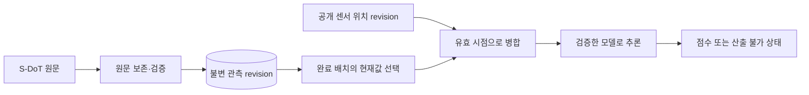

# SafeNight 로컬 백엔드

S-DoT 환경 관측과 공개 센서 위치를 수집·보존하고 모델 추론 API를 제공하는 Python 서버입니다. 기본 배포 경로는 [Sites 클라우드 실행본](../cloud/README.md)이며, 이 폴더는 개발·재현을 위한 PostgreSQL 기반 구현입니다. Docker 없이 실행합니다.

현재 활성 수집 원천은 S-DoT입니다. CCTV 조회·영상 기능은 제거했고, CCTV 키는 설정하지 않습니다. 과거 어댑터·학습 자료에 남은 시설 관련 필드는 이전 자료의 계보를 위한 것으로 현재 서비스 기능이나 모델 입력을 뜻하지 않습니다.

## 실행

Python 3.12와 `uv`가 필요합니다. 아래 명령은 모두 `backend/`에서 실행합니다.

```sh
uv sync --locked
cp .env.example .env
chmod 600 .env
```

예제 복사는 새 설치에서만 합니다. `.env`에는 `SAFENIGHT_SDOT_API_KEY`와 `SAFENIGHT_DATABASE_URL`을 설정합니다. 키는 브라우저 코드나 API 응답에 전달하지 않습니다.

개발용 PostgreSQL을 별도 터미널에서 실행합니다.

```sh
uv run scripts/local_postgres.py
```

출력된 Unix socket 연결 주소를 `.env`에 넣은 뒤, 다른 터미널에서 다음을 실행합니다. 개발 DB의 로컬 socket 인증은 공개 운영 DB 설정으로 사용하지 않습니다.

```sh
uv run safenight migrate
uv run safenight download-locations
uv run safenight collect sdot --day 2026-11-03
uv run scripts/train_random_forest.py
uv run safenight serve
```

날짜는 원천 제공 기간 안의 날짜로 바꿉니다. `SAFENIGHT_MODEL_BUNDLE_DIR`는 모델 폴더, `SAFENIGHT_WEB_DIST`는 별도로 빌드한 로컬 화면 폴더입니다. 기본 화면 경로는 `../work/safenight/dist`입니다.

## 수집과 저장

원문 응답은 `raw_objects`에 보존합니다. 동일한 바이트와 동일한 정규화 revision은 중복 저장을 줄이고, 정정된 값은 이전 이력과 함께 남깁니다. `DATA_NO`와 원천 수정 시각으로 현재값을 선택하고, 우선순위를 정할 수 없는 동순위 충돌은 거절합니다.

페이지 누락·반복·총행수 변화·파싱 오류가 있으면 현재값과 완료 지점을 게시하지 않습니다. 이미 보존한 원문은 남깁니다. 성공 배치의 정규화 저장·현재값 선택·완료 지점 변경은 한 트랜잭션입니다.

공개 센서 위치는 관측 시점에 유효한 revision으로 결합합니다. 위치 파일을 새로 적재했다고 S-DoT의 중간 날짜를 모두 수집한 것으로 간주하지 않습니다. 현재 다운로드 대상은 공식 2026-03-10 파일이며, 새 파일의 자동 탐지는 구현하지 않았습니다.



## 정기 작업과 API

```sh
uv run safenight schedule
# 현재 필요한 작업만 한 번 실행
uv run safenight schedule --once
```

로컬 스케줄러는 별도 프로세스입니다. 매일 03:00 KST에 완료된 전날을 수집하고, 누락 구간과 최근 7일의 정정을 재검사합니다. 실패 후에는 재시도 유예를 적용합니다. 29일을 넘긴 공백은 `archive_backfill_required`로 남기며 임의로 건너뛰지 않습니다. 로컬 프로세스의 OS 자동 시작은 등록하지 않았습니다. 컴퓨터와 무관하게 실행할 정기 작업은 Sites의 클라우드 운영 경로를 사용합니다.

| API | 응답 |
|---|---|
| `GET /health/live` | 프로세스 상태 |
| `GET /health/ready` | DB 연결과 실제 모델 로딩 상태 |
| `GET /sources` | 활성 원천의 수집 상태와 완료 지점 |
| `GET /observations?source=sdot&limit=20` | 현재 선택된 관측 revision |
| `GET /features/{sensor_id}` | 관측·위치 병합 입력과 계보 |
| `GET /assessments/{sensor_id}` | 점수 또는 사유, 모델·입력 버전 |
| `GET /map` | 지점별 최신 관측·좌표·추론 결과 |

위 경로는 `/api` 접두어로도 제공합니다. CCTV 주변 조회 경로는 없습니다. 로컬 HTTP API는 원천 수집이나 모델 업로드를 실행하지 않습니다.

## 모델 경계와 검증

`model_runtime.py`의 `load_model()`이 신뢰한 모델을 시작 시 한 번 읽습니다. `RuntimeAdapter`가 지도와 개별 평가 API의 공통 경계입니다. 입력·출력 계약을 유지하면 모델 어댑터를 바꿀 수 있습니다. 새 입력이 필요한 모델은 수집·feature 계약도 함께 바꿔야 합니다.

현재 임시 RF는 조도·소음으로 기존 `safety_index`를 재현합니다. 학습 센서 ID, 좌표, 입력 범위, 관측 신선도를 검사하며 시설 개수를 사용하지 않습니다. 입력 결측·오래된 관측·지원 범위 밖·예측 오류에서는 점수를 `null`로 반환합니다. 새로운 관측마다 재학습하지 않으며 `.ipynb`를 서버에서 실행하지 않습니다.

```sh
uv run ruff check .
uv run basedpyright
SAFENIGHT_TEST_DATABASE_URL='<별도 시험 PostgreSQL 주소>' uv run pytest -q
```

DB 주소가 없으면 DB 시험이 건너뛰어집니다. 실제 PostgreSQL을 지정한 최신 로컬 시험은 **76개 통과**입니다. 사이트 클라우드 시험과 운영 이관 결과는 [검증 기록](VALIDATION.md)에 따로 적습니다. 모델 교체 방법은 [안내](../docs/model-replacement.md)를 참고하세요.

`model_artifacts`, `active_models` 테이블은 향후 레지스트리 확장을 위한 스키마입니다. 현재 파일의 해시 검증과 모델 로딩은 구현했지만 DB 레지스트리의 자동 승인·배포 전환은 연결하지 않았습니다. 초기 스키마 이후의 로컬 DB 변경에는 별도 순차 migration 체계가 필요합니다.

원천: [서울시 S-DoT 환경정보](https://data.seoul.go.kr/dataList/OA-22833/A/1/datasetView.do).
