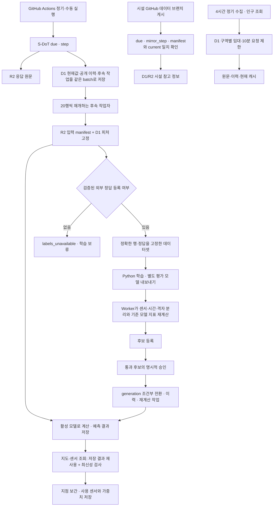
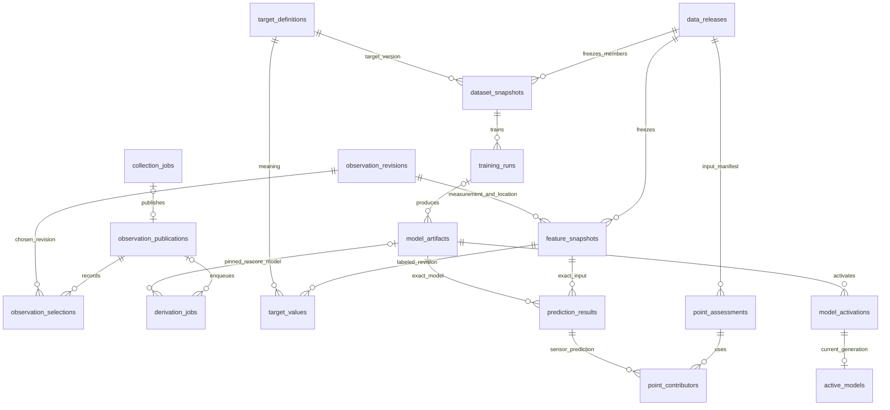

# SafeNight 파이프라인과 DB 구조 보정

2026-11-05. 제공된 「SafeNight 코드 기반 구조 분석 및 기존 초안 적용 비교안」을 바탕으로 **실행 코드와 DB를 함께 수정**했다. 원격 기준은 `6a63e7a`이다. 이전 로컬 폴더에 없던 시설·인구 코드를 원격 main에서 먼저 반영했다. 기존 D1은 17개 테이블·4개 마이그레이션이며, 이번 변경은 기존 테이블을 보존하고 16개를 추가한다. 전체는 **33개 테이블·238개 컬럼**이다.

- [스키마](../cloud/db/schema.ts), [추가 마이그레이션](../cloud/drizzle/0004_pipeline_lineage.sql)
- [전체 컬럼](database-columns.csv), [물리적 외래키](database-foreign-keys.csv)
- [실행 API](../cloud/app/server/pipeline/http.ts), [수집 후 계산](../cloud/app/server/pipeline/derive.ts)

운영 DB의 마이그레이션·사이트 배포·GitHub 비밀 설정은 이번 코드 변경과 구분한다. 아래의 구현 검증은 로컬 D1/R2와 별도 임시 PostgreSQL에서 수행했다.

## 실제로 바뀐 흐름

D1/R2가 웹 서빙의 기준 저장소다. Python은 고정된 내보내기 파일을 읽는 학습 작업자다. PostgreSQL의 기존 독립 수집·분석 기능은 유지하며, 두 DB의 양방향 정정 동기화를 추가하지 않았다.

현재 `environment-v1`의 회귀 입력은 조도·소음이다. 시설·인구는 참고 정보이며 이 입력 버전의 점수를 바꾸거나 재학습을 유발하지 않는다. 공개 인구 121개 구역의 4시간 정기 수집과 위치 XLSX 변경 감지는 추가했다. 시설·인구를 포함한 새 모델 입력과 미래 관측 예측은 포함하지 않는다.

위치는 매일 02:45 KST 공식 목록에서 최신 XLSX를 확인한다. SHA-256과 적용일로 기존 성공·중간 작업을 구별하며, 같은 파일은 재적재하지 않고 중단된 파일은 페이지부터 재개한다. 손상·좌표 오류 자료는 공개 전에 차단한다. 인구 내부 API는 한 요청에서 최대 3구역을 처리하며 기존 D1 임대·원본 보존·오류 시 이전 캐시 유지 정책을 공유한다. [위치 실행기](../cloud/scripts/sync-locations.mjs) · [인구 API](../cloud/app/api/internal/population/route.ts)

## 테이블 관계

기존 17개는 수집 9개(`collection_jobs`, `raw_objects`, `observation_revisions`, `current_observations`, `latest_observations`, `job_revisions`, `job_pages`, `source_checkpoints`, `operation_guards`), 시설 5개(`context_snapshots`, `context_current`, `context_refresh_jobs`, `context_raw_documents`, `context_staged_sources`), 인구 3개(`population_raw_objects`, `population_observations`, `population_cache`)다.

| 추가 테이블 | 한 행의 단위와 핵심 관계 |
|---|---|
| `observation_publications` | 공개 배치. 증가하는 sequence, 실제 공개 단계의 시각, 수집 작업 FK. 업그레이드 baseline은 별도 origin |
| `observation_selections` | 배치 × 원천 × 센서 × 측정시각. 그때 선택된 수정본 FK |
| `derivation_jobs` | 종류 × 입력 버전 UNIQUE. 공개 배치 또는 모델 FK, 임대·시도 횟수·오류·재개 커서 |
| `data_releases` | 봉인한 R2 manifest 주소·해시와 사용 가능 cutoff |
| `feature_snapshots` | 관측/위치 수정본 쌍 + 피처 버전으로 만든 ID. 관측과 위치를 각각 FK로 보존 |
| `target_definitions` | 외부 규칙 지수의 의미·출처 설명·제공자가 기재한 원본 해시를 고정한 버전 |
| `target_values` | 피처 수정본 × 목표 버전 UNIQUE. 정답값·목표시각·시스템 등록시각·고정 파일 참조 |
| `dataset_snapshots` | 정확한 학습 행과 정답을 담은 R2 JSON의 주소·해시·분리 정책·표본 수 |
| `training_runs` | 학습 실행. dataset/입력/목표 버전 복합 FK, code SHA·seed·설정·평가 결과·상태 |
| `model_artifacts` | 모델 버전·숫자 트리 파일·해시·학습 실행·승인 기록. 기존 배포 번들은 origin=bundled 예외로 구분 |
| `model_activations` | 모델 이름 × generation PK. 이전 모델·사유·담당자·시각을 남기는 전환 이력 |
| `active_models` | 모델 이름별 활성 generation. 전환 이력의 이름/세대/모델 복합 FK |
| `prediction_results` | feature × model × policy UNIQUE. 피처와 모델의 입력 버전도 복합 FK로 일치시킴 |
| `point_assessments` | 지점·평가시각·정책·release별 보간 결과 |
| `point_contributors` | 지점 결과 × 실제 센서 예측 결과 PK. 거리와 정규화 가중치 |
| `population_request_leases` | 구역별 외부 요청 임대와 다음 허용 시각. 여러 isolate가 공유 |

데이터셋의 실제 구성원, 지점의 시설 스냅샷 등 대용량·가변 관계는 R2 manifest 안의 논리 참조다. 물리적 FK와 구분해야 한다. `dataset_snapshots → training_runs → model_artifacts`는 입력·목표 버전을 복합 FK로 일치시킨다. 모델 원본과 학습 파일은 실행 가능한 pickle이 아니라 검증하는 JSON이다.

## 공개 시점과 정정 처리

시간은 UTC `YYYY-MM-DDTHH:mm:ss.sssZ`로 정규화한다.

| 시각 | 의미 |
|---|---|
| `observed_at` | 측정 또는 위치 적용 시각 |
| `published_at` | 원천 발표·정정 시각 |
| `ingested_at` | 시스템에 수집한 시각 |
| `observation_publications.available_at` | 페이지 검증을 마치고 공개 batch에 진입한 시스템 시각 |
| 피처 `as_of` | 피처의 관측 기준시각 |
| `available_cutoff` | 입력 선택에 허용한 공개시각 상한 |
| 정답 `available_at` | 외부 정답을 시스템에 등록한 시각. 과거 시각으로 소급하지 않음 |

수집 완료에서는 임대 검사 → current/latest 선택 → 공개 기록·선택 이력 → 후속 계산 작업 → checkpoint·성공 상태가 같은 D1 batch에 들어간다. 후속 작업 저장에 실패해도 공개 포인터가 함께 롤백된다. 요청을 재전송해도 같은 성공 작업의 공개·후속 작업은 하나다. 수집 시작 전에 잡은 시각을 공개시각으로 재사용하지 않도록 실제 수집 API에 별도 공개 clock을 연결했다.

`readSensorsAt()`은 cutoff까지 공개된 선택 이력만 읽는다. 동일 밀리초의 공개는 sequence로 구분한다. 정정 전 cutoff에는 정정 전 관측과 위치가 선택된다. 공개 이력을 기록하기 전의 실제 과거 공개시각은 추정하지 않는다.

업그레이드 시 보호된 `bootstrap`이 **그 시점의** current 포인터를 baseline으로 한 번 기록한다. 기존 자료는 그 baseline부터 재현할 수 있다. 이전 수집시각을 이용해 과거의 공개 완료를 소급 증명하지 않는다. 운영 조회는 기존 current/latest 포인터를 계속 사용한다.

## 후속 계산과 조회

후속 작업은 120초 임대와 조건부 batch로 소유권을 확인하고, **20행씩** 저장한다. DB에 원천 키 커서·처리 행 수가 남는다. 작업자가 중단되면 임대 만료 후 이어 가며, 실제 실패를 관찰하면 임대를 풀고 오류 코드를 남긴다.

S-DoT 공개는 해당 관측 키를 계산한다. 위치 정정은 같은 센서의 영향을 받는 관측을 공개 sequence 기준으로 다시 연결한다. 먼저 페이지 키를 제한한 뒤 인덱스로 관측·위치 수정본을 선택하므로 매 행마다 전체 이력의 순위를 다시 계산하지 않는다. 미위치 관측은 release에 남지만 점수를 만들지 않는다.

피처 ID는 기존 API의 `feature_revision`과 같은 관측 ID·위치 ID·피처 버전 해시다. 같은 입력을 재확인해도 피처와 결과가 중복되지 않는다. 점수는 모델의 정적 지원 조건에 대한 결과로 저장하고, 응답 시에는 현재 시각에 대한 30시간 만료를 다시 검사한다. 저장된 점수가 있다는 이유로 오래된 관측을 현재 값처럼 반환하지 않는다. 새 피처의 계산이 아직 끝나지 않았으면 `DATA_UNAVAILABLE`과 null을 반환한다.

bootstrap 이후 지도·센서 조회는 활성 모델의 저장 결과를 읽는다. 센서 단건 API는 해당 센서만 조회한다. 지점 보간에서는 실제 사용한 예측 ID·거리·가중치를 저장한다. 아직 bootstrap하지 않은 전환 기간에만 기존 번들 직접 계산을 유지한다. 활성 포인터가 있는데 파일이 없거나 해시 검증이 실패한 경우에는 번들로 조용히 돌아가지 않는다.

## 정답과 고정 학습 데이터

새 관측을 새 정답으로 간주하지 않는다. 현재 저장소에는 원래 전체 입력 산식을 실행하는 모듈이 없으며, 현재 두 입력만으로 소음 변동·시설 항목까지 포함한 원래 지수를 다시 만들 수 있다고 가정하지 않는다. [기존 기준 설명](scoring-and-serving.md)과 현재 모델 입력을 구분한다.

운영자는 보호된 `labels` 명령으로 피처 ID·값·목표시각과 목표 정의를 등록한다. 규칙 지수는 목표시각이 피처의 관측시각과 같아야 한다. 같은 목표 버전에서 이미 등록한 값을 고쳐 덮어쓰지 않는다. 정답 정정은 새 정의 버전을 등록한다. 제공자가 기재한 원본 출처·해시 자체를 독립 인증한 것은 아니며, 이 API는 **정답과 정의를 정규화한 JSON으로 고정·해시 검증**하는 경계다. 모델 예측값을 정답으로 자동 채우지 않는다.

데이터셋 생성은 공개 이력상 선택된 정확한 관측·위치 쌍과 등록 정답만 연결한다. 최신 정정본의 정답이 없으면 이전 정답으로 대체하지 않는다. 파일에는 각 피처·정답 ID, 입력값, 원천 release, 목표 버전·값·시각, 입력·정답 사용 가능 시각이 들어간다. 파일 내용의 SHA-256이 dataset ID다. 같은 내용·코드의 완료 학습을 반복 예약하지 않으며, 정답이 없으면 `labels_unavailable`로 종료한다.

한 데이터셋은 현재 최대 10,000행이다. 더 큰 학습 집합은 한도를 넘어 조용히 자르지 않고 오류를 반환한다. 대규모 분할 내보내기는 별도 확장 대상이다.

## 학습·검증·승인·전환

`train-pipeline.mjs`가 인증된 API에서 고정 파일을 내려받아 해시를 확인한 뒤, 잠금된 Python 프로젝트 환경에서 `train_pipeline.py`를 호출한다. Python은 DB나 인증 토큰을 읽을 필요가 없으며, 현재 RF 설정을 유지해 최종 모델과 분리 평가용 모델들을 내보낸다. Worker는 전달된 점수를 신뢰하지 않고 평가 모델을 고정 정답에 적용해 MAE·RMSE를 다시 계산한다.

`seed=42`, `sensor-time-region-v1`의 분리 규칙은 다음과 같다.

- 센서: 센서 ID의 안정된 해시 순서로 20% 센서를 평가에 배정. 센서 중복 금지.
- 시간: 마지막 UTC 관측일 평가. 이전 입력·정답이 첫 평가시점까지 실제로 사용 가능해야 학습에 포함.
- 지역: 위경도 0.02도 격자를 같은 방식으로 분리. 동일 격자의 학습/평가 중복 금지.

서버는 임의로 쉬운 행만 선택하지 못하도록 정확한 분리 소속과 평가 모델의 학습 위치·센서 목록도 확인한다. 세 평가가 모두 있어야 하고, 각 평가에서 학습 100행·5센서 이상, 평가 30행·2센서 이상이 필요하다. 후보의 MAE와 RMSE가 학습 평균·중앙값 기준의 더 좋은 값보다 모두 작아야 한다. 최종 입력 지원률은 95% 이상이며, 기존 모델과 공통 지원되는 평가 행에서는 오차가 악화되면 안 된다. 기존 모델 비교가 가능한 행 수와 각 지표도 남긴다.

이는 코드로 검사하는 최소 통과 조건이다. 장기 일반화, 통계적 유의성, 실제 범죄·사고·체감안전 타당성을 증명하지 않는다. 후보 등록은 학습 완료와 구분하며, `passed=false`는 승인할 수 없다. 정기 학습은 후보만 등록하고, 운영 전환은 명시적으로 요청해야 한다.

`approve`는 평가 당시의 운영 모델이 아직 같은지 확인한다. `activate`는 예상 generation과 승인 상태를 batch 안에서 다시 검사하고, 전환 이력·활성 포인터·재계산 작업을 함께 기록한다. 같은 generation을 두 실행기가 교체하면 하나만 성공한다. 복귀도 새 generation을 만들며, 동일 모델로 돌아와도 이전 재계산 작업과 충돌하지 않는다. 요청은 한 번 읽은 모델 버전과 입력을 고정한다.

## 정기 실행과 시설·인구 경계

- S-DoT: [`collect-sdot.yml`](../.github/workflows/collect-sdot.yml), 매일 18:00 UTC = 다음 날 03:00 KST. 기존 due/step과 7일 정정 재확인 후 후속 작업을 소비한다.
- 시설: 기존 데이터 브랜치 게시 다음에 callback을 연결했다. 네 단계 완료, 최종 `context_current`, 이 작업에서 고정한 manifest의 해시가 게시 파일과 일치해야 완료로 본다. 같은 날 이미 다른 manifest로 완료한 경우에는 성공으로 가장하지 않고 불일치를 보고한다.
- 학습: [`train-model.yml`](../.github/workflows/train-model.yml), 일요일 19:30 UTC = 월요일 04:30 KST. 미처리 피처를 정리한 뒤 고정 데이터로 학습하며, 정답이 없으면 보류한다. 수동 실행의 `promote`를 선택한 경우에만 통과 후보를 승인·전환한다.
- 인구: 여러 isolate가 같은 구역을 동시에 조회해도 D1 임대로 한 요청만 허용한다. 성공·실패 모두 10분 요청 제한을 유지한다. 사용자가 조회하지 않은 구역·시각을 수집했다고 간주하지 않는다.

워크플로와 callback은 배포 준비 변수 `SAFENIGHT_PIPELINE_ENABLED=true` 이후에 작동한다. 코드 push만으로 구버전 사이트에 새 API 호출을 시작하지 않도록 했다. `SAFENIGHT_COLLECT_AUTH_TOKEN`과 사이트의 별도 접근 토큰이 필요하면 `SAFENIGHT_SITE_BYPASS_TOKEN`을 GitHub Secrets에 설정한다. 값은 공개 파일·로그에 남기지 않는다.

## 적용 순서와 검증

1. 운영 D1을 백업하고 기존 `0000`~`0003` 뒤에 `0004_pipeline_lineage.sql`을 적용한다. 신규 DDL이며 기존 데이터의 삭제·재작성·초기 데이터 삽입은 없다.
2. 새 서버 코드를 빌드·배포하고 토큰을 설정한다. 이 저장소에는 운영 DB 식별자를 추정한 배포 명령을 추가하지 않았다.
3. 보호된 `bootstrap`과 `step` 또는 `node cloud/scripts/pipeline-client.mjs derive`를 실행해 기존 관측의 baseline·피처·결과를 만든다.
4. 결과를 확인한 뒤 GitHub 변수 `SAFENIGHT_PIPELINE_ENABLED=true`를 설정한다. 두 정기 실행과 시설 callback을 확인한다.
5. 정답의 출처와 의미를 확인해 등록한다. 새 정답이 없다면 수집·계산·품질 확인까지만 운영한다.

R2 업로드는 D1 트랜잭션에 포함되지 않는다. 객체를 먼저 저장하고 다시 읽어 해시를 확인한 뒤 DB 참조를 공개한다. 중간 실패 후 남는 미참조 객체는 재시도 시 재사용할 수 있으며, 자동 삭제 작업은 아직 없다. 참조된 불변 객체를 임의로 덮어쓰거나 삭제하면 안 된다. D1 batch의 원자성은 [Cloudflare 공식 설명](https://developers.cloudflare.com/d1/worker-api/d1-database/#batch)을 따른다.

검증에는 실제 로컬 Worker HTTP 경로·D1·R2, 별도 임시 PostgreSQL, Python sklearn 학습을 사용했다. 두 날짜의 합성 자료로 피처·정답 등록 → 데이터 고정 → Python 학습 → Worker의 세 분리 평가 재계산 → 승인·활성 전환 → 결과 재계산·조회까지 통과했다. 이 합성 자료의 통과를 운영 데이터의 모델 성능으로 해석하지 않는다. 원격 배포, 실제 API 인증·장기 운영·부하 시험은 이 로컬 검증에 포함하지 않는다.

운영자가 외부 정답을 정확한 수정본에 연결할 때는 인증된 `GET /api/internal/pipeline?features_after=`로 피처 ID·센서·관측시각·관측/위치 수정본을 200개씩 내보낼 수 있다. `next_cursor`를 다음 호출에 전달하고 null이면 끝이다. 정답 정의의 `rule_version`은 생성 의미의 버전이며, 파일마다 달라지는 `source_sha256`은 해당 정답 파일의 출처 기록이다. 파일 해시만 달라졌다고 동일 규칙의 목표 버전이 쪼개지지 않도록 분리했다.

최종 로컬 검증 결과(2026-11-05): Cloud **201개 통과**, Python **81개 통과**, 실패·건너뜀 0. Cloud 전체 시험은 `SAFENIGHT_PIPELINE_PYTHON_QA=1`로 실제 Python 학습까지 포함했다. Python 전체 시험에는 새 임시 PostgreSQL을 사용했다. TypeScript 타입 검사·변경 파일 ESLint·Worker 빌드, Python Ruff·basedpyright·새 Python 파일의 no-excuse 검사를 통과했다. TypeScript 보조 no-excuse 스크립트는 프로젝트의 5.9 버전에서 제공하지 않는 TypeScript 7 API를 요구하므로 사용하지 못했으며, 기존 프로젝트의 타입·린트 검사를 사용했다. Drizzle SQL 적용으로 33개 테이블·238개 컬럼·외래키 컬럼 43개를 확인했다.

정답 등록은 한 번에 최대 200행이며, 조회와 삽입은 D1 바인딩 수에 맞춰 묶는다. 동시 등록에서 같은 목표 버전·피처에 다른 값이 들어오면 DB의 고유 제약으로 전체 등록을 거부한다. 정답 파일 해시를 바꿔 기존 값을 덮어쓸 수 없다.
