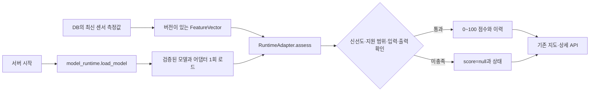

# 모델 교체 안내

사이트·수집기·데이터베이스는 모델 구현과 분리되어 있다. 현재와 같은 입력 및 출력 계약을 지키는 모델은 API 경로, 지도 컴포넌트, 수집기와 DB 테이블을 수정하지 않고 교체할 수 있다. 새 데이터 항목이나 다른 예측 대상이 필요한 경우에는 해당 계약과 데이터 처리도 함께 바꿔야 한다.

## 교체 지점

서버 시작 경로는 다음과 같다. HTTP 요청마다 모델을 다시 읽거나 학습하지 않는다.



| 파일 | 역할 | 모델 교체 시 작업 |
|---|---|---|
| `backend/src/safenight_backend/model_runtime.py` | 실제 `safenight serve`와 Docker에서 사용하는 단일 로더 | 다른 알고리즘이면 `load_model()`의 import와 반환 어댑터를 교체 |
| `backend/src/safenight_backend/serving/runtime.py` | 공통 `RuntimeAdapter` 계약과 `ServiceRuntime` | 계약 유지 |
| `backend/src/safenight_backend/serving/contracts.py` | `FeatureVector`, `Predictor`, `ServingPolicy`, `Assessment` | 같은 입력과 출력이면 유지 |
| `backend/src/safenight_backend/serving/service.py` | 결측·신선도·지원 범위·출력 범위 확인 | 일반 모델은 재사용 |
| `backend/src/safenight_backend/rf/runtime.py` | 현재 RF의 공간·관측 범위 확인 | 새 알고리즘의 어댑터로 대체 가능 |
| `backend/src/safenight_backend/rf/artifact.py` | 현재 RF JSON 로딩과 해시 확인 | 같은 형식의 모델 파일 교체 시 재사용 |

`create_app(..., runtime_factory=...)`도 같은 계약을 사용한다. 이 인자는 fixture 및 통합 시험용 주입 지점이며, 일반 실행에서는 `model_runtime.load_model()`이 자동 호출된다. HTTP로 로더 이름이나 실행할 코드를 받지 않는다.

## 같은 RF 형식의 모델 파일만 바꾸기

`SAFENIGHT_MODEL_BUNDLE_DIR`에는 `model.json`과 `manifest.json`이 들어 있는 디렉터리를 지정한다. manifest의 SHA-256, 버전, 학습 위치·입력 범위와 트리 구조가 맞지 않으면 시작 단계에서 거부한다. 두 파일은 한 묶음으로 배포해야 한다.

현재 저장된 학습 스냅샷에서 새 디렉터리로 내보내는 명령은 다음과 같다.

```bash
cd backend
uv sync --locked
uv run scripts/train_random_forest.py --output var/models/candidate
SAFENIGHT_MODEL_BUNDLE_DIR=var/models/candidate uv run safenight serve
```

이 명령은 기존 스냅샷으로 명시적으로 다시 학습한다. 새 관측값이 DB에 들어오는 것만으로 재학습하거나 서비스 모델이 바뀌지는 않는다. 배포 전 후보 모델을 별도로 검증하고, 기존 디렉터리를 보존하여 설정을 되돌릴 수 있게 한다. 모델은 시작 시 고정되므로 파일 또는 설정을 바꾼 뒤 API 프로세스를 재시작해야 한다.

기본 Docker 이미지는 빌드 단계에서 현재 학습 스냅샷으로 RF 번들을 생성한다. 다른 번들을 사용하려면 컨테이너에서 보이는 디렉터리에 읽기 전용으로 마운트하고 `SAFENIGHT_MODEL_BUNDLE_DIR`를 그 경로로 지정한다. 다른 알고리즘으로 전환할 때에는 로더·의존성·이미지의 모델 생성 단계도 새 배포 방식에 맞춰야 한다. [Docker 실행 안내](docker.md)를 참고한다.

## 다른 알고리즘 붙이기

1. 신뢰할 수 있는 서버 코드에 새 모델 어댑터를 작성한다. `Predictor.version`, `Predictor.feature_version`, `predict(FeatureVector) -> float`를 구현한다.
2. 학습으로 검증된 센서 집합과 필수 입력, 최대 관측 나이를 `ServingPolicy`에 명시한다. `AssessmentService`가 공통 검사를 수행하도록 한다. 현재 RF처럼 추가적인 좌표·입력 범위 검사가 필요하면 전용 `RuntimeAdapter`에서 먼저 확인한다.
3. `ServiceRuntime(AssessmentService(...), MapModelInfo(...))` 또는 전용 `RuntimeAdapter`를 반환하는 로더를 만든다. metadata의 모델 버전과 실제 predictor 버전이 같아야 한다.
4. `model_runtime.py`의 `load_model(directory)`가 그 어댑터를 반환하도록 바꾼다. 서버·지도·수집·DB 코드는 그대로 사용한다. 필요한 라이브러리는 `backend/pyproject.toml`과 `uv.lock`에 함께 반영한다.
5. 아래 fixture·실제 DB 통합 시험과 새 모델의 별도 검증을 통과한 뒤 배포한다.

fixture 어댑터는 `backend/tests/test_model_runtime.py`에만 있다. 서비스 모델이나 검증 성능을 대신하는 값으로 사용하지 않는다.

## 입력 및 출력 계약

현재 `feature_version`은 `environment-v1`이다.

| 필드 | 형식·단위 | 의미 |
|---|---|---|
| `sensor_id` | 비어 있지 않은 문자열 | 관측 센서 식별자 |
| `observed_at` | 시간대가 있는 일시 | 원본 관측 시각 |
| `lat`, `lon` | 위도·경도 또는 `null` | 센서 위치 |
| `lux` | 0 이상 실수 또는 `null` | 조도 lx |
| `noise_db` | 0~200 실수 또는 `null` | 소음 dB, 원본 수집기의 허용 범위는 더 좁을 수 있음 |
| `cctv_count` | 0 이상 정수 또는 `null` | 현재 피처 생성에서 확인되지 않은 값은 `null` |
| `feature_version`, `revision` | 비어 있지 않은 문자열 | 입력 계약 버전과 원본 계보 |

결측을 임의의 0으로 채우지 않는다. 현재 RF는 좌표·조도·소음을 요구하고 CCTV 개수는 사용하지 않는다. 학습에 포함된 센서, 해당 학습 좌표에서 250m 이내, 학습에서 관측된 조도·소음 범위 안에서만 점수를 낸다. 관측 신선도 기본값은 30시간이다.

출력 `Assessment`는 `score`(유한한 0~100 또는 `null`), `status`, 관측·평가 시각, 모델·피처·정책 버전, 피처 revision을 포함한다. 점수가 높을수록 환경 안전도가 높다는 기존 화면 의미를 유지한다. 모델이 위험도나 확률을 출력하면 어댑터에서 의미와 변환을 명확하게 정의해야 한다.

`MODEL_UNAVAILABLE`, `DATA_UNAVAILABLE`, `STALE`, `SCHEMA_MISMATCH`, `UNSUPPORTED`, `MODEL_ERROR`에서는 숫자 점수를 만들지 않는다. 정상 점수는 `SCORED`다. 예상 가능한 모델 추론 실패는 `PredictionError`로 보고한다. 프로그래밍 오류를 임의 점수로 숨기지 않는다.

현재 점수는 기존 `safety_index`를 대상으로 한 실험용 환경 안전도다. 알고리즘만 바꾸는 작업으로 실제 범죄·사고 위험의 타당성이나 성능이 보장되지는 않는다. 현재 입력 계약에 없는 가로등·영상 집계 등을 모델에 추가하려면 수집원, 시간·공간 결합, 피처 버전, 결측 처리, 검증 자료도 함께 갱신해야 한다.

## 교체 전 검증

```bash
cd backend
uv run ruff check .
uv run basedpyright
uv run pytest -q tests/test_model_runtime.py tests/test_serving.py tests/test_random_forest.py
```

실제 PostgreSQL에 연결할 수 있는 별도의 시험 DB 주소를 `SAFENIGHT_TEST_DATABASE_URL` 환경변수로 지정한 다음 전체 시험을 실행한다. 시험은 임의의 독립 스키마를 생성하고 제거한다. 키와 DB 비밀번호를 문서나 저장소에 넣지 않는다.

```bash
uv run pytest -q
```

`test_model_runtime.py`는 RF 파일이 없는 디렉터리에서도 다른 알고리즘을 로드해 입력 변화가 점수에 반영되는지, 기본 로더 교체가 일반 실행 경로에 적용되는지, 신선도·미설정·주입 우선순위가 유지되는지 확인한다. `test_map_api.py`는 실제 PostgreSQL 관측 자료를 통해 지도 API와 개별 평가 API가 동일한 교체 모델의 점수·버전을 반환하는지 확인한다. 수집·DB 시험은 시험 DB 주소가 없으면 건너뛰므로, 건너뛴 결과를 통합 검증 완료로 간주하면 안 된다.
