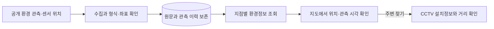

# SafeNight 프로젝트 실적 설명서

밤길을 걸을 때 주변 환경과 시설 정보를 함께 확인할 수 있으면 좋겠다는 생각에서 SafeNight를 기획했다. 조도·소음 같은 환경 관측과 CCTV 등 시설 위치를 지도에 연결해, 사용자가 선택한 장소 주변의 정보를 살펴볼 수 있는 서비스를 목표로 했다.

## 공개데이터를 서비스에 연결하기까지

초기 작업에서는 서울시 환경 센서와 CCTV·가로등·보안등 자료를 직접 찾아 항목과 단위를 확인했다. 이름이 비슷한 열이라도 같은 의미로 쓸 수 있는지 살펴보고, 관측 레코드의 개수와 실제 장소의 개수가 다르다는 점을 구분했다. 위도·경도의 순서와 국내 좌표 범위를 점검하며 서로 다른 자료를 위치 기준으로 연결할 준비를 했다.

화면은 React와 Google AI Studio를 활용해 구성했다. CSV의 열 이름을 서비스에서 사용하는 변수와 대응시키고, 지도에서 장소를 선택해 주변 정보를 확인하는 흐름으로 연결했다. 자료를 표로 보여 주는 데서 끝내지 않고, 사용자가 어느 위치의 정보인지 확인할 수 있게 하는 것이 중요했다.

이 과정에서 공개데이터를 내려받는 일과 서비스에서 쓸 수 있는 상태로 만드는 일이 다르다는 것을 배웠다. 단위, 좌표, 관측 시각, 시설 집계 기준을 맞추지 않으면 그럴듯한 화면이 있어도 장소를 설명하는 근거가 될 수 없다. 내가 맡은 역할은 서비스 아이디어와 방향을 정하고, 필요한 공개데이터를 찾아 기준을 확인하며, 데이터를 지도 화면으로 연결하는 이용 흐름을 구체화하는 것이었다.

## 수집 서버와 데이터베이스로 확장

2026년 11월에는 정적 파일을 읽던 초기 구조를 공공데이터 수집 서버와 PostgreSQL 데이터베이스를 사용하는 구조로 확장했다. S-DoT 환경 관측과 공개 센서 위치를 수집하고, 내려받은 원문과 처리 이력을 남기도록 구성했다. 같은 자료의 중복 저장을 줄이고, 원천 값이 정정되면 이전 이력도 보존한다.

일별 수집은 별도의 스케줄러에서 실행한다. 수집 도중 응답 형식이나 페이지 수에 문제가 있으면 완료한 것으로 기록하지 않고, 다음 실행에서 누락 구간을 다시 처리한다. 웹 요청과 정기 수집을 분리해 화면을 여는 행동이 대량 수집을 시작하지 않도록 했다.

사용자 화면에서는 지도·지역 검색·환경 관측값·관측 시각을 중심으로 정보를 정리했다. 주변 CCTV는 버튼을 누를 때 해당 위치의 설치정보를 조회하고 거리를 계산한다. 개발용 수집 상태와 내부 진단 내용은 일반 이용 화면에서 덜어냈다. Docker에는 화면과 API 서버, 별도의 DB를 구성해 실행 환경을 재현할 수 있게 했다.

## 실제로 확인한 범위

| 구분 | 확인한 내용 |
|---|---|
| 원천 수집 | S-DoT 하루 응답 29,200행을 처리해 고유 관측 revision 24,715개 저장 |
| 센서 위치 | 공개 위치 파일에서 1,170개 센서 위치 저장 |
| 주변 시설 | 선택 지점의 주변 CCTV 설치정보를 실제 API로 조회하고 거리순 표시 |
| 실행 환경 | Docker의 API 서버와 PostgreSQL 컨테이너 실행·상태 확인 |
| 오류 처리 | 중복·정정·페이지 누락·수집 실패·입력 부족을 구분하는 fixture 검증 |

수집 수치는 2026년 11월 4일 검증한 결과이며, 이후 갱신에 따라 달라진다. 관측 revision 수는 서로 다른 장소의 수를 뜻하지 않는다.

공공 영상 API는 승인 대기 중이다. 주변 도로 영상 제공과 실시간 보행자 수 집계는 완료한 실적으로 포함하지 않는다. 안전 우회 경로 추천, 실제 SOS 전송, 경찰서·공공기관 전화 안내, 임의 주소에 대한 거리 가중 평가는 이후 연결할 기능이다.

## 배운 점과 다음 작업

이 프로젝트를 진행하며 자료의 출처와 기준을 확인하는 작업이 화면 구현만큼 중요하다는 점을 배웠다. 이제는 새 데이터가 들어왔다는 사실, DB에 보존됐다는 사실, 사용자가 현재 확인할 수 있는 정보를 구분해 설명하려 한다. 승인된 영상 소스와 추가 시설 자료를 연결할 때도 실제로 검증한 범위부터 확장할 계획이다.

---

정리 기준: 로컬의 `SafeNight_포트폴리오.pdf`(2026년 10월, 6쪽)와 현재 저장소의 구현·실행 검증 기록. 원본의 모델 구상·계산식·가중치·평가·지수 분포는 이 정리본에서 제외했다. 초기 기록의 관측 수와 시연용 대체값은 최신 실적으로 옮기지 않았다. 원본 문서와 원본에 기재된 공동 발표자료의 기여 구분은 유지하며, 원본 PDF는 수정하지 않았다.
