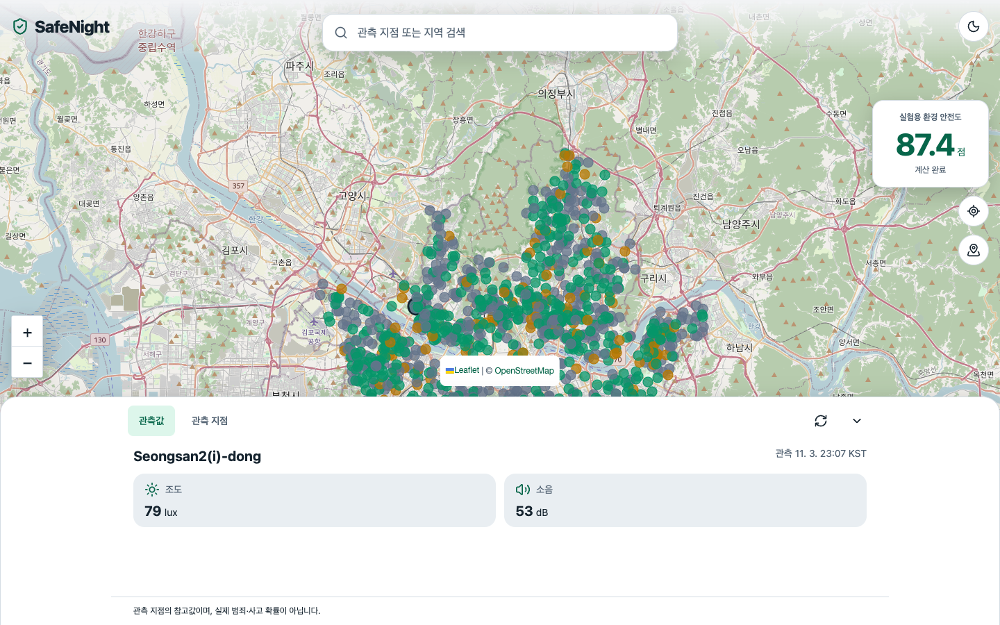

# SafeNight 실적 설명서

**실적물 제목: 공공데이터 수집·저장 기반 환경정보 지도 서비스 SafeNight**

작성자 신유민 · 정리 기준 2026년 11월 4일

## 1. 제작 계기

밤길을 걸을 때 주변 환경을 판단하는 데 도움이 되는 정보를 한 화면에서 확인할 수 있으면 좋겠다고 생각했습니다. 지도에서 위치만 찾는 데서 나아가, 해당 지점이 얼마나 밝고 시끄러운지와 그 정보가 언제 관측됐는지를 함께 보여 주는 서비스를 구상했습니다.

처음에는 서울시 환경 센서 자료와 주변 시설 자료를 찾아 CSV를 지도에 연결하는 방식으로 구현했습니다. 그러나 원천 자료가 갱신될 때마다 파일을 바꾸는 방식으로는 새 자료와 정정 이력을 관리하기 어려웠습니다. 이에 수집과 화면 조회를 분리하고, 원문과 관측 이력을 보존하는 서버·데이터베이스 구조로 확장했습니다.

## 2. 서비스 개요와 본인 역할

SafeNight는 서울시 S-DoT의 조도·소음 관측을 센서 위치와 연결해 지도에 표시하는 웹서비스입니다. 사용자는 관측 지점이나 지역명을 검색하고, 지도에서 지점을 선택해 관측값과 실제 관측 시각을 확인할 수 있습니다. 현재 운영은 Sites의 클라우드 서버와 D1·R2 저장소를 사용하며, 로컬 컴퓨터나 Docker를 켜 두지 않아도 실행되도록 구성했습니다.

저는 서비스의 문제와 방향을 정하고, 필요한 공개데이터와 사용할 항목을 찾아 확인했습니다. 지도에서 지점을 선택해 근거를 살펴보는 이용 흐름, 일별 수집과 데이터 보존, 불필요한 기능을 덜어내는 방향을 구체화했습니다. 초기 화면에는 Google AI Studio와 React를, 이후 서버·저장소 확장과 검증에는 Codex를 활용했습니다. 공동 발표자료의 참여자와 본인의 기여 범위는 구분합니다.

| 구분 | 사용 자료·구성 |
|---|---|
| 환경 관측 | 서울시 S-DoT 조도·소음 자료 |
| 위치 자료 | 공식 공개 센서 위치 파일 |
| 화면 | React 기반 지도·검색·지점 선택 |
| 서버·저장소 | Sites / Cloudflare Workers · D1 · R2 |
| 개발·재현 | Python 서버 · PostgreSQL · GitHub |

## 3. 제작 과정

### Step 1. 원천 자료의 항목과 위치 연결 확인

서울시 S-DoT 응답과 공개 센서 위치 파일을 확인하고, 서비스에서 사용할 항목을 구분했습니다. 센서 식별자로 관측과 위치를 연결하되, 관측 시각과 자료 공개 시각을 구분했습니다. 조도의 단위는 lux, 소음의 단위는 dB로 확인했습니다. 응답 행 수를 서로 다른 장소의 수로 해석하지 않고, 빈 관측값도 임의의 숫자로 채우지 않도록 했습니다.

| 원천 항목 | 서비스에서 확인하는 정보 |
|---|---|
| SERIAL | 관측 지점의 센서 식별자 |
| SENSING_TIME | 실제 관측 시각 |
| DATE | 원천 자료 공개·갱신 시각 |
| AVG_INTE_ILLU / AVG_NOISE | 조도(lux) / 소음(dB) |
| 센서 위치 파일의 위도·경도 | 지도에 표시할 위치 |

### Step 2. 원문·관측 이력·현재값을 분리해 저장

수집한 응답은 R2에 원문으로 먼저 보존하고, 형식·시간·페이지를 검증한 뒤 D1에 처리 중인 관측 이력으로 저장합니다. 모든 페이지가 확인된 경우에만 사용자에게 보여 줄 현재값과 수집 완료 지점을 함께 변경합니다. 중간에 실패한 자료를 완성된 자료처럼 게시하지 않는 구조입니다.

같은 응답의 중복, 원천 값의 정정, 페이지 누락, 수집 중단 후 재개를 구분해 시험했습니다. 마지막 페이지 저장 직후 작업이 끊기면 재개 시 다음 페이지를 불필요하게 요청하는 문제가 발견됐습니다. 저장한 행 수와 전체 행 수가 같을 때는 추가 수집 없이 게시를 마무리하도록 수정하고, 이 상황을 다시 실행하는 시험을 추가했습니다.

구현 근거는 `cloud/app/server/cloud/jobs.ts`와 `finalize.ts`, 저장소 시험은 `cloud/tests/cloud-store.test.mjs`에서 확인할 수 있습니다.

### Step 3. 관측 근거를 확인하는 지도 화면 구현

지도에서 관측 지점을 선택하거나 센서·지역명을 검색하면 조도, 소음, 관측 시각이 함께 표시되도록 했습니다. 화면 새로고침은 저장된 자료를 다시 조회하며 대량 수집을 시작하지 않습니다. 오래된 자료와 관측값 부족 상태를 구분하고, 개발용 진단과 불필요한 화면 요소를 정리했습니다.

초기 기획에는 CCTV와 영상 기능도 있었지만 API 승인 대기가 이어졌습니다. 이에 현재 서비스에서는 CCTV 조회·영상·인원 집계를 제외하고 환경 관측을 확인하는 흐름에 집중했습니다.

위 이미지는 2026년 11월 4일 CCTV 제거 후 로컬 재현 환경에서 확인한 화면입니다. 클라우드 수집 성공 여부는 다음 단계의 별도 검증 기록으로 확인했습니다.

### Step 4. 클라우드 이전과 실제 수집 확인

기존 관측·위치 이력 25,885개와 원문·백업을 클라우드 저장소로 이전했습니다. 이후 로컬 API와 Docker를 중지한 상태에서 Sites 서버가 2026년 11월 3일 하루의 S-DoT 응답 29,200행을 직접 수집했고, 11월 4일 20:30 KST에 성공을 확인했습니다.

| 확인 항목 | 결과 |
|---|---|
| 실제 원천 수집 | S-DoT 하루 응답 29,200행 |
| 센서 위치 | 공식 2026-03-10 공개 파일의 위치 1,170개 |
| 수집 후 저장 | 추가 이력 2,700개, 관측·위치 이력 합계 28,585개 |
| 정기 작업 | 매일 오전 3시(Asia/Seoul) 클라우드 일정 등록·활성화 |

관측·위치 이력 수는 장소 수나 이용자 수가 아닙니다. 첫 정기 예약은 2026년 11월 5일 오전 3시로, 작성 시점에는 아직 예약 실행 전입니다. 실제 원천 수집 성공과 일정 등록, 장기간의 자동 운영 검증은 구분합니다.

## 4. 제작 후기와 보완 계획

자료를 지도에 표시하는 것과 새 자료를 계속 받아 관리하는 것은 다른 작업이었습니다. 처음에는 데이터를 연결하는 화면에 집중했지만, 서버로 확장하면서 원문을 남기는 순서와 중단된 작업의 재개 조건까지 확인해야 했습니다. 이 과정에서 화면에 보이는 결과뿐 아니라 그 결과를 만든 자료와 처리 이력을 설명할 수 있어야 한다는 점을 배웠습니다.

또한 구현하고 싶은 기능을 모두 남겨 두기보다 현재 확보한 자료와 승인 상태에 맞춰 범위를 조정했습니다. 앞으로도 구현 여부와 검증 결과를 나누어 기록하려 합니다. 현재 정기 수집 대상은 S-DoT이며, 센서 위치 새 파일 자동 탐지와 가로등·보안등 추가 수집은 후속 과제입니다.

## 5. 실적 확인 자료

- [배포된 SafeNight](https://safenight-seoul-2026.true-tang-8939.chatgpt.site/) · 현재 소유자 계정으로 접속
- [GitHub 구현 코드](https://github.com/roberYM11/safenight)
- [원천 수집·저장·배포 검증 기록](../backend/VALIDATION.md)
- [정기 수집 운영 절차](../cloud/public/CLOUD_OPERATIONS.md)
- [제출용 PDF](../output/pdf/SafeNight_실적설명서.pdf)

기존 SafeNight_포트폴리오.pdf(2026년 10월, 6쪽)의 기획·데이터·구현·기여 기록과 현재 코드·검증 결과를 대조했습니다. 원본 PDF는 수정하지 않았고, 초기 시연용 대체값과 검증하지 않은 효과는 실적으로 옮기지 않았습니다.
