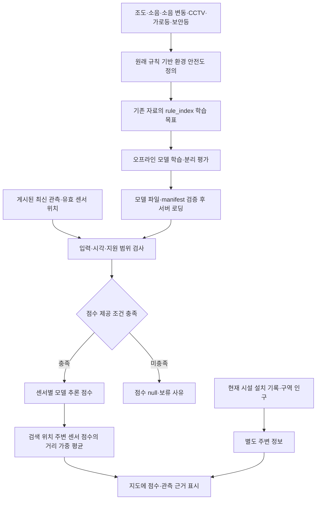

# 안전도 스코어링과 모델 서빙 체계

정리 기준: 2026-11-04. 현재 배포 소스 v7과 GitHub의 모델·입력 계약을 대조했다. 이 문서의 목적은 **무엇을 안전도의 기준으로 삼았고, 현재 모델은 무엇을 계산하며, 어떤 조건에서 결과를 제공하는가**를 설명하는 것이다.

## 1. 전체 체계



현재 연결된 RF의 예측 입력은 조도·소음 두 개다. 원래 목표식에 소음 변동과 시설 항목이 있다는 사실과, 현재 요청에서 그 항목을 실제 입력한다는 것은 다르다. **현재 CCTV·가로등·보안등·인구 조회값은 점수에 합산하지 않는다.**

## 2. 원래 스코어링: 무엇을 점수로 만들었는가

분석 단위는 센서 한 곳의 특정 시각 관측이다. 기존 분석 프로젝트의 10개 입력 순서는 다음과 같다.

```text
lux_max, lux_avg, lux_min,
noise_max, noise_avg, noise_min, noise_range_proxy,
cctv, light, security
```

10개 입력을 아래 여섯 구성요소의 규칙 점수로 변환했다. 전체 입력을 사용하는 모델 실험과 현재 두 입력 모델을 구분한다.

| 구성요소 | 원래 사용 값 | 점수식의 반영 |
|---|---|---|
| 조도 | 평균 조도 | 조도 부담 I의 30% 차감 |
| 소음 | 평균 소음 | 구간별 소음 부담 N의 15% 차감 |
| 소음 변동 | (최대 소음 − 최소 소음) / 4 | 변동 대리항 T의 10% 차감 |
| CCTV | 기존 반경 25m의 CCTV 좌표 행 수 | 보완항 C의 25% 가산 |
| 가로등 | 같은 반경의 가로등 좌표 행 수 | 보완항 G의 15% 가산 |
| 보안등 | 같은 반경의 보안등 좌표 행 수 | 보완항 B의 5% 가산 |

L은 평균 조도, n은 평균 소음, v는 소음 변동 대리값이다. clip은 지정 범위 밖의 값을 경계값으로 제한한다.

```text
v = (noise_max - noise_min) / 4
I = clip(100 - L/3, 0, 100)

N = clip(100 - 2.5n, 0, 100)          (n < 40)
    (n - 40) × 20/30                (40 ≤ n ≤ 70)
    min(100, 20 + (n - 70) × 80/40)  (n > 70)

T = 50                              (n = 0)
    clip(50 - 100v/(n+0.00001), 0, 100)  (그 외)

C = min(100, CCTV좌표행수 × 25)
G = min(100, 가로등좌표행수 × 20)
B = min(100, 보안등좌표행수 × 30)

S = clip(100 - .30I - .15N - .10T + .25C + .15G + .05B, 0, 100)
```

원식은 기존 분석 프로젝트의 `src/safenight/scoring/index.py`, 입력 순서는 같은 프로젝트의 `scoring/features.py`, 변동 대리값 정의는 `docs/METHOD.md`에서 확인했다. 현재 저장소에는 그 원식 실행 모듈이 없고, 계산된 `rule_index`를 연결한 [학습 snapshot](../backend/data/training/README.md)과 [원천 해시 기록](../backend/data/training/environment_proxy.provenance.json)이 있다. 위 수식은 원래 기준을 문서로 복원한 것이며 현재 서비스에 새로 적용한 수식이 아니다.

가중치와 소음 구간은 프로젝트의 설계 가정이다. v는 관측 시계열의 표준편차가 아니며, 이 식에서 변동이 커질 때 T가 작아져 차감량이 줄어드는 방향도 원식 그대로다. 비음수 입력에서는 원식의 점수가 50~100에 놓이므로 명목상 0~100 범위 전체를 쓰는 척도로 해석하지 않는다. 시설 좌표 행 수는 중복·제공 범위에 영향을 받으며, 실제 작동 대수나 범죄 예방 효과를 뜻하지 않는다.

## 3. 현재 모델: 어떤 입력으로 무엇을 예측하는가

| 항목 | 현재 연결된 RF |
|---|---|
| 예측 입력 | 평균 조도 lux, 평균 소음 noise_db |
| 별도 검사값 | 센서 ID·좌표·관측 시각·입력 버전·revision |
| 학습 목표 | 기존 전체 요소 점수인 predictions.csv의 rule_index |
| 학습 자료 | 2025-10-12의 5개 시각, 3,230행·652센서 |
| 모델 | RandomForest, 트리 114개·최대 깊이 18·최소 leaf 3·seed 42 |
| 평가 | 센서 단위 20% holdout 후 전체 snapshot으로 최종 적합 |
| 기록된 평가값 | MAE 8.2808점, R² −0.0211 |
| 현재 시설·인구 조회값 | 예측 입력에 포함하지 않음 |

근거: [학습 코드](../backend/src/safenight_backend/rf/training.py), [현재 manifest](../cloud/app/server/data/manifest.json).

현재 모델은 원래 기준을 두 변수로 근사하는 임시 모델이다. 누락된 소음 변동·시설 기여를 직접 계산하지 않는다. R²가 음수인 평가에서 높은 재현 성능을 확보했다고 주장할 수 없으며, 이 평가는 실제 범죄·사고 예측 정확도를 측정한 것도 아니다.

## 4. 현재 서빙: 언제 점수를 제공하는가

새 자료 수집과 모델 학습은 분리한다. 명시적인 학습으로 만든 `model.json`과 `manifest.json`을 검증해 로딩하고, 요청 시 게시된 관측에 고정 모델을 적용한다. Python은 시작 시, Workers는 isolate에서 최초 로딩한 번들을 재사용한다.

| 검사 | 현재 기준 | 실패 시 처리 |
|---|---|---|
| 모델 파일 | SHA-256·버전·트리 구조·manifest 일치 | 로딩 거부 |
| 관측·필수값 | 관측·좌표·조도·소음 존재 | DATA_UNAVAILABLE |
| 관측 시각 | 미래가 아니며 관측 후 30시간 이내 | 미래는 UNSUPPORTED, 초과는 STALE |
| 입력 계약 | environment-v1 일치 | SCHEMA_MISMATCH |
| 센서·위치 | 학습 센서 ID이며 해당 학습 위치에서 250m 이내 | UNSUPPORTED |
| 입력 범위 | 조도 0~467 lux·소음 35~74 dB | UNSUPPORTED |
| 추론 출력 | 유한한 0~100 값 | 정상은 SCORED, 잘못된 출력은 MODEL_ERROR |

보류 시 `score: null`을 반환한다. 점수 0과 자료 부족을 구분한다. 개별 평가 응답에는 관측·평가 시각, 모델·입력·정책 버전과 입력 revision이 있다. 모델 없음 상태도 정의돼 있지만, 배포 경로의 번들 로딩 예외가 모두 해당 상태로 변환되는 것은 아니다.

근거: [Python 공통 서빙](../backend/src/safenight_backend/serving/service.py), [RF 지원 범위](../backend/src/safenight_backend/rf/runtime.py), [클라우드 추론](../cloud/app/server/forest.ts), [공통 요청 경로](../cloud/app/server/serving.ts).

## 5. 검색한 위치의 점수와 시설 정보

현재 사이트는 검색 좌표를 센서 좌표로 바꾸지 않는다. 반경 1.5km 안에서 정상 점수가 있는 가까운 최대 8개 센서를 골라 다음 가중치를 정규화한다.

```text
w_i = 1 / max(25, 거리_i(m))²
장소 참고점수 = Σ(w_i × 센서점수_i) / Σw_i
```

이는 기존 센서 점수의 보간이며 검색 위치의 소음 변동·시설을 새 모델에 넣은 추론이 아니다. 사용한 센서 수·거리·관측 시각 범위를 함께 반환한다.

시설은 검색 위치 반경 1km의 공개 설치 기록을 별도로 조회한다. 현재 확보 범위는 송파구·서초구이며, CCTV는 공개 카메라 대수와 설치 기록 수를 구분한다. 인구는 해당·인근 공식 집계 구역의 참고값이다. 두 종류 모두 `score_included: false`로 제공한다.

근거: [위치 평가](../cloud/app/server/location-assessment.ts), [시설 집계](../cloud/app/server/context-data.ts), [인구 조회](../cloud/app/server/population.ts).

## 6. 전체 요소를 실제 점수 입력으로 전환할 때

원래 구성요소를 유지하려면 **소음 변동·CCTV·가로등·보안등을 포함한 새 입력 계약과 모델**이 필요하다. 시설 조회 API가 있다는 것만으로 기존 모델의 입력 구성이 바뀌지는 않는다.

1. 최대·최소 소음의 관측 구간을 맞추고 변동 대리값을 정의한다.
2. 센서 위치와 시설의 기준일·반경·중복·자료 제공 범위를 검증해 결합한다. 현재 화면의 반경 1km 집계를 원래 25m 학습 열에 그대로 넣지 않는다.
3. 필수 자료의 미확보와 검증된 0을 구분한다. 전체 요소 체계에서 필수값이 없으면 산출을 보류하도록 계약을 정한다.
4. 목표식의 방향·가중치·상한을 검토하고 입력·목표·정책 버전을 함께 고정한다.
5. 같은 장소·시각의 누출을 막아 후보를 평가하고, 단순 기준과 비교한 후 번들·어댑터·시험을 함께 교체한다.

현재 새 관측마다 자동 재학습하거나 성능 임계값으로 자동 승격하는 시스템은 없다. [모델 교체 안내](model-replacement.md)를 따른다. 현실의 안전도를 주장하려면 규칙 재현 평가와 별도로 실제 안전 결과에 대한 검증이 필요하다.
